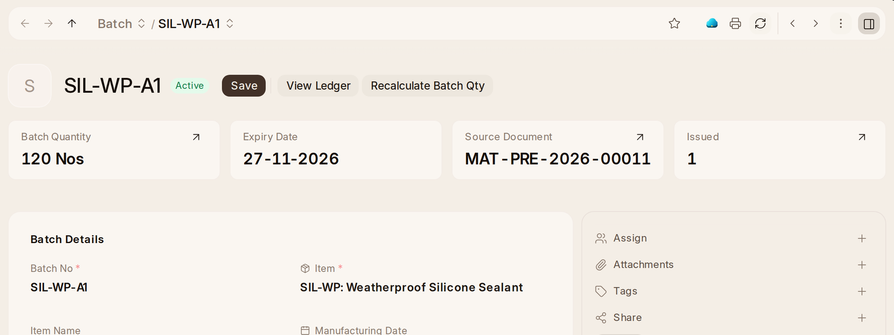

# Batches and Quality

**Batch** and **Serial No** in the rail list lots (batches) and numbered
pieces. A batch row shows its item, how much is left and when it goes off;
open one, and **Connections** on the right shows what each warehouse holds
of it under **Stock Levels**, where **Move** and **Split** are. A serial number shows its status, where
it is or the customer it went to, its lot, and when its warranty ends. The
lots going off within a month are on Home under **Expiring Soon**.

### Tracking Batches and Serials

On an item's **Inventory** tab, **Track by Batch or Serial No** sets the item
up to be kept in lots or by number in one step: **By Batch** or **By Serial
No**, whether new lots are numbered for you and how (**Automatically Create
New Batch**, **Batch Number Series**), whether lots go off and how many days
one keeps (**Has Expiry Date**, **Shelf Life In Days**), or how serial
numbers run and how long the warranty is. It is offered only for an item
that has never moved, since how an item is kept cannot change once it has.
**New Batch** makes a lot by hand, with when it was made and when it goes
off; left empty, the date is worked out from how long the item keeps. Each
receipt asks which lot or numbers came in.

An item's **Inventory** tab shows its lots and numbers. A lot's page says
when it expires, amber within a month and red once past, so it is used,
sold or taken out of stock first. The stock managers are told once when a
lot with some left will expire within a month. **Batch Item Expiry
Status** and **Available Batch Report** are under Reports.

A lot's page says what is left (**Batch Quantity**), its **Manufacturing
Date** and **Expiry Date**, the receipt it came from (**Source Document**),
and how many times some was taken out (**Issued**), which opens its trace.

{one_ai} answers **Which lots go off soon?** and **Where is each numbered
piece?** on the page.

## Quality

A **Quality Inspection**, under Everything on Home, checks goods on the way
in, on the way out or while they are made, reading by reading against what
they should be. A receipt can require one before it is submitted.

How work is done, what went wrong and what is done about it (procedures,
goals, non conformances and actions) is {one_quality}'s.
