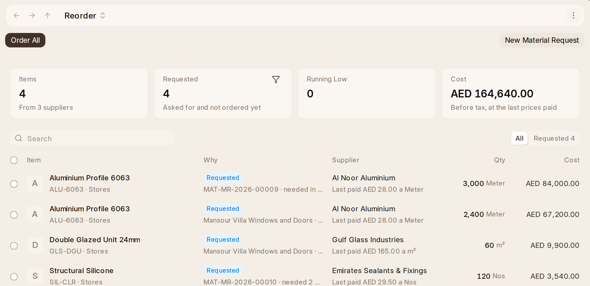

# Buying

**Buying** in the rail goes the way buying does. It holds **Reorder**,
**Material Request**, **Request for Quotation**, **Purchase Order** and
**Supplier**. Supplier Quotations, the Supplier Quotation Comparison report
and Blanket Orders are under Everything on Home. Suppliers are kept in
{one_book}, and the link here opens the same supplier. A supplier's **Items**
tab says what is bought from them, item by item: their own code for it,
whether they are its default supplier, the last price paid in their money
and what it was before, or what they agreed on a blanket order, how much was
bought in a year and in how many orders, what is on order and the lead time;
then what they quoted for and were never ordered from. Each opens the item's
Buying tab, which says the same from the item's side, and **New Purchase
Order** starts one with them.

1. **Ask for it.** Somebody who needs goods makes a **Material Request**,
   saying what, how many, for which warehouse and project, and when it is
   wanted.
   Its page says the **Project**, who it was **Requested By**, and under
   **Progress** how far it has got: Requested, Quoted (how many suppliers
   answered), Ordered and Received.
   The list leads with the title, which
   names the items, so it has no number column; a request's lines take the request's
   Required By and leave it out of the table.
2. **Ask for prices.** On a material request, **Create › Request for
   Quotation** makes the request for the lines still to buy. Add the
   suppliers, submit it, and **Send Emails to Suppliers** mails each one a
   link. A supplier with a portal login prices it there, and their quote
   arrives as a draft with whoever asked told. A quote by mail is **Create
   › Supplier Quotation** on the request. A quote holds until its **Valid
   Till**, and expires by itself after. From a project, **Ask for Prices**
   on its **Suppliers** does all of it in one step.
3. **Compare.** **Request for Quotation** in the rail lists the requests,
   and **Supplier Quotation** the quotes. A request's page says how many
   suppliers have **Quoted** and who is **Cheapest**, line by line, and
   **View › Supplier Quotation Comparison** sets its quotes side by side,
   in the company's money too. A quote past its **Valid Till** is never the
   cheapest. **Create › Order Cheapest** on the request drafts one order to
   each supplier for the lines they are cheapest on; nothing is sent. A
   quote says on how many of its lines it is the cheapest (**Lowest On**).
   {one_ai} answers **Who has not answered?** and **Who is cheapest?** on a
   request.
4. **Order.** **Create › Purchase Order** on the quote you take. Lines can
   go to different suppliers, each from whoever is cheapest on it.
   A supplier's **Items** tab lists everything bought from them: the last
   price paid, how much in a year, what is on order and the lead time, and
   what they quoted for and were never ordered from.
   An order's page says the **Project**, its **Grand Total** while it is a
   draft, the **Blanket Order** it is agreed on, and under **Progress** how
   far it has got: Ordered, Received (in red once late) and Billed.
   **Supplier's Quote No** keeps the number on the supplier's own
   quotation as they wrote it (Q-12548 Rev 2), changeable after submit, and
   the order's print says it beside Required By.
   **Submit** sends nothing by itself. Print it or
   mail it from its menu. The list gives the supplier room for its name and
   the status room for "To Receive and Bill", without the number, and a
   line's own Required By stays out of the items table.
5. **Receive and pay.** See Receiving. The supplier's bill is
   **Create › Purchase Invoice**, and it is {one_book}'s from there.

- **Late orders.** Once a day, an order whose goods are past the date they
  were wanted and not all here is told to whoever made it (**Order Late**),
  once. Services are never late, and a closed order is done with. Close an
  order with **Status › Close** when nothing more is coming.
- **A price for the year.** A **Blanket Order** agrees a price and a
  quantity with a supplier from one date to another. An order line that
  names it is held to its price, and the blanket order says how much of it
  is **Ordered** so far. It prints as a **Blanket Order** for the supplier
  to sign.
- **Scoring suppliers.** A **Supplier Scorecard** scores a supplier each
  month on what was delivered on time and what was accepted on arrival, and
  can warn or stop a new order to a supplier who scores poorly. Its criteria
  come from the Inventory Check.
- **Buying Settings** (Setup) hold the buying price list, whether an order
  or a receipt must come before a bill, and how much over a request may be
  ordered.

## Ordering What Runs Low

Give an item a reorder level on its page's **Inventory** tab (**Set Reorder
Level**): the warehouse, the level, and how many to order each time. Once a
day, anything at or below its level gets a **Material Request** by itself.

**Buying › Reorder** lists what needs ordering: every request not yet
ordered, and every item that is low and not yet requested — why it is
there, how many, for which warehouse, from whom (the item's default
supplier, or whoever it was last bought from), what it last cost a unit and
what the line would cost. The figures above say how many lines
(**Items**), how many **Requested** and **Running Low**, and what it all
comes to before tax (**Cost**). Tick the
lines and press **Order** (or **O**), or **Order All** with none ticked: one draft
purchase order is made for each supplier, and lines with no supplier go to
the one you pick (**Who Supplies the Rest?**). **New Material Request**
asks for something by hand. A supplier billed in another currency gets
their order in it. Read the drafts, correct prices and quantities, and submit
them. A request line held by draft orders leaves the list, and no order,
however it is made, can order more of a request line than is left on it.
A request is marked ordered when its order is submitted.

Purchasing is told of both: a request reordering raised (**Material Request
Raised**) and one a person asked for (**Material Request Asked**). A customer's
order not all delivered by its date is told the next morning to whoever made
it and the stock managers (**Delivery Late**).

A request to move, issue or make something reaches whoever keeps the stores,
or makes it (**Stock Asked**). Whoever asked hears when it is all moved or
issued (**Material Request Done**) and when somebody stops it
(**Material Request Stopped**). When reordering could not raise a request,
the stock and buying managers are told within the hour (**Reordering
Failed**). Subcontracted goods a day late back are told to whoever ordered
them (**Back From Supplier Late**).
