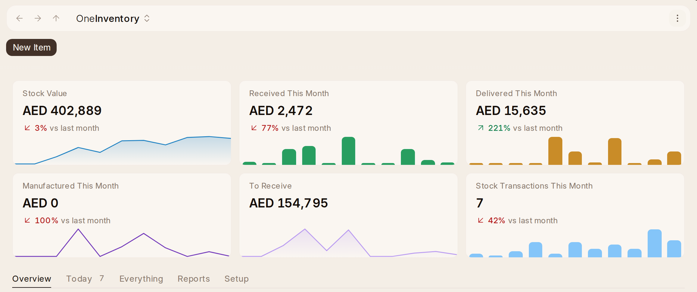

# What {one_inventory} Is

{one_inventory} is what the company holds: the goods it buys and sells or uses up
(stock), and the equipment it keeps — laptops, vehicles, tools (assets). It is
where things arrive from suppliers, leave for customers and move between
places, and where you order more. What the company makes is {one_factory}'s. It shares
its records with {one_book}, so a delivery here is the same record an invoice in
{one_book} is made from, and an asset's depreciation lands in {one_book}'s books by
itself.

## Finding Your Way

**{one_inventory}** in the dock opens it on **Home**. Over it, six figures,
each against last month and drawn over its months: **Stock Value**,
**Received This Month**, **Delivered This Month**, **Manufactured This
Month**, **To Receive** (still on order) and **Stock Ledger Entries This
Month** (how many moves). Each opens its list. **New Item**, **New Purchase
Receipt**, **New Stock Entry** and **New Material Request** start one.

- **Overview** opens first. A button for each kind of thing that needs
  somebody (3 Late Orders, 1 Item Running Low) leads to Today. Then the story
  of the stock, in five parts:
  - **Where Stock Is**: its worth by warehouse, by item group, and the most
    valuable items.
  - **How Stock Moves**: its worth month by month, what came in and went out
    each month by kind, where goods came from and went (supplier to
    warehouse to customer, project or the workshop), the busy days, and the
    papers by kind.
  - **How Old Stock Is**: its worth by age, as the **Stock Ageing** report
    counts it.
  - **Buying**: how far the material requests got, what was bought from
    each supplier, and how each supplier keeps to its dates.
  - **Equipment**: its worth by kind, bought against now, the assets by
    status, and the services by month.

  A slice or a bar opens what it stands for: a warehouse's stock, an item
  group's items, a supplier's orders, the assets in a status.
- **Today** lists what needs somebody, each kind only when there is some:
  **Late Orders** (purchase orders with goods past their date), **Running
  Low** (with **Order**, which opens Reorder), **Expiring Soon** (lots near
  or past their date), **Maintenance Due** (late or due this week) and **Left as Drafts** (receipts,
  deliveries, moves and counts started more than a day ago). Each row opens
  what it is about.
- **Everything** lists all of {one_inventory}, each with a line saying what it
  is for, under Stock, Buying, Quality, Assets, Reports and
  Setup, and a
  search. **Reports** and **Setup** in the rail open their part of it.

The rail keeps what people use every day:

- **Item**, **Stock Summary**, **Purchase Receipt**, **Delivery Note**,
  **Stock Entry** (moves), **Stock Reconciliation** (counts) and **Batch and
  Serial No**, which holds lots and serial numbers together. See Batches and
  expiry dates.
- **Buying** — **Reorder**, **Material Request**, **Request for Quotation**,
  **Purchase Order** and **Supplier**. See Buying.
- **Assets** — **Asset** and **Asset Maintenance Log**.
- **Reports** — the stock, buying and asset reports, each with what
  it shows.
- **Setup** — the **Inventory Check** first (what is missing before stock
  can be kept right), then warehouses with their putaway rules, stock
  dimensions and stock closings, item groups, brands, units and attributes
  (from {one_inventory}'s **Lists**) with variant settings, supplier groups and
  scorecard variables, price lists, asset
  categories, locations, maintenance teams, shift factors, delivery
  settings, and the stock and buying settings.

Everything else (blanket orders, asset movements, pick lists,
packing slips, delivery trips, landed costs, item prices, item alternatives,
lead times, standard costs, quality inspections, supplier scorecards,
value adjustments, asset
capitalization and shift allocations) is in **Everything** on Home. When
something about stock, buying or assets is not on the rail, look
there first.

## What Is Kept Where

{one_crm} keeps customers, quotations and the sales order a won deal becomes;
{one_book} keeps invoices, bills, payments and suppliers; {one_inventory} keeps
items, stock, what arrives and what is delivered, what is ordered from
suppliers, and the company's equipment. {one_factory} keeps what the company
makes.

## Several Companies

With more than one company, each stock, buying and asset record says its
**Company**, starting as yours, and every list can show and filter by it.
A warehouse belongs to one company, so a record offers only that company's
warehouses. Home, **Stock Summary**, **Reorder** and an item's figures are
your company's alone, in its currency. Someone limited to one company sees
only its records. With one company, none of this shows.
