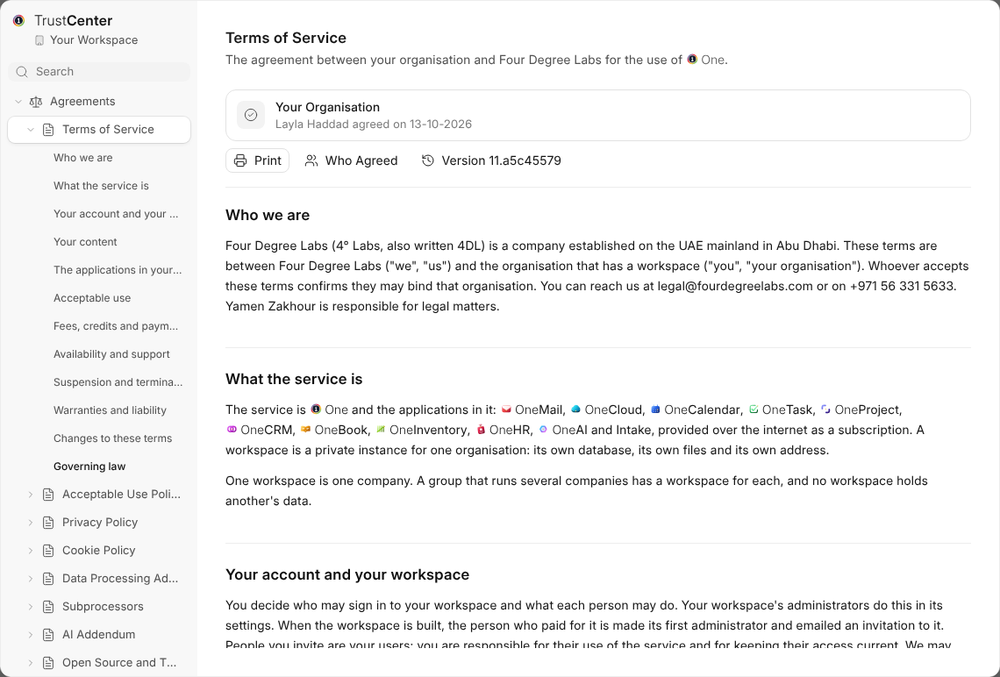

OneLegal holds the agreements One runs under, and TrustCenter shows all of
it. This is the version it is released at.

- Open TrustCenter from the shield in the bottom bar. A module's foot opens
  only that module's part of it.
- Each agreement says whether you and your organisation agreed, and asks
  only when it is owed. Earlier versions stay readable.
- Optional services, such as pictures from Gravatar or web search, stay off
  until an administrator turns them on.
- A new version is told, not asked: administrators by mail, everybody in
  the bell, with the day it takes effect.
- **Who Agreed** shows who agreed to each agreement, and when, to
  administrators and to a role given it.

HelpCenter explains all of it, starting with What TrustCenter Is.

