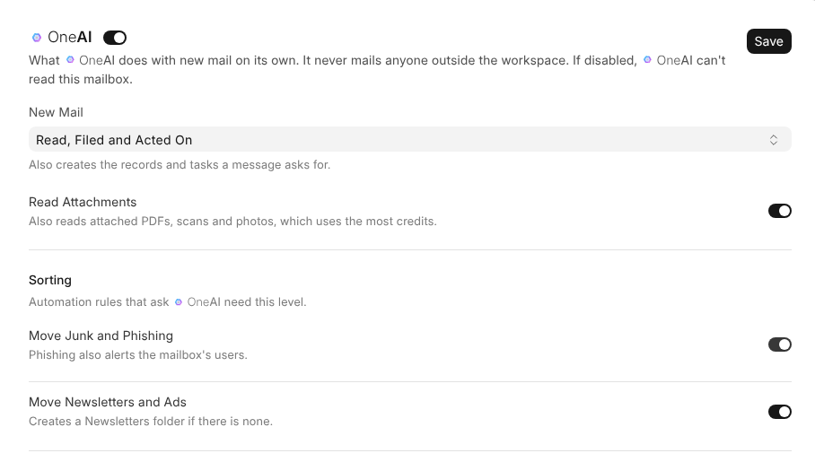

# OneAI in Your Mail

OneAI helps when you ask, in the panel and while you write, and can read a
mailbox's new mail on its own. It never sends mail for you, and never mails
anyone outside the workspace.

## Asking in the Panel

The OneAI panel knows the mailbox, folder and conversation you have open.

| Ask | You get |
| --- | --- |
| **Summarise this conversation** | Who wants what, what was agreed and what's still open |
| **Draft a reply**, saying what it should say | A reply in the conversation's language, on a card. **Approve** opens it in the email window to edit and send. |
| **What needs an answer?** | Conversations in the folder where the last message came to you, oldest first |

## Asking It to Change Something

Anything you can change in OneMail you can also ask OneAI for, in your own
words. It answers with a card saying exactly what will change, and nothing
changes until you press **Approve**. It is then done as if you had done it
yourself, so what your role can't do, the card can't either.

| Ask, for example | What the card does |
| --- | --- |
| *Archive everything from the courier* | Moves, archives, trashes, stars or marks conversations as read |
| *Make a folder for Acme* | Makes, renames or deletes a folder |
| *File this on the villa project* | Puts the conversation on a record, or takes it off |
| *I'm away from the 3rd to the 10th* | Turns your out-of-office reply on or off |
| *Turn off the taxi rule* | Turns a rule on or off, deletes it, or approves one somebody asked for |
| *Give Huda the sales mailbox, reading only* | Shares a workspace mailbox with one person, or stops sharing it |
| *Let people connect their Gmail* | Changes how the workspace's mail is set up |
| *Add our domain rua.ae* | Adds or removes the company's mail domain |

> **What OneAI never does.** It never connects a mailbox or gives one its
> password again, because it never sees a password. It doesn't change how
> much it reads a mailbox or spends on it: that's for the mailbox's manager,
> in the **OneAI** tab. And it doesn't stop a mailbox from being read; its
> holder does that on the **Connection** tab.

## While You Write

The OneAI button next to **Message** in the email window works on what you're
writing:

| Choose | For |
| --- | --- |
| **Improve it**, **Make it shorter**, **Make it longer** | The length and the flow |
| **Make it more formal**, **Make it friendlier** | The tone |
| **Fix spelling and grammar** | Mistakes |
| **Translate…** | Another language |
| **Write a first draft**, **Reply saying…** | An empty reply |
| Your own words | Anything else |

OneAI reads your text, the subject, the recipients and the message you're
answering, never your signature. **Approve** replaces your text and keeps your
signature and the quoted message.

## Reading New Mail

In a mailbox's **OneAI** tab, OneAI becomes the colleague who reads its new
mail. The switch beside the title decides whether OneAI may read the mailbox at
all; off, nothing reads it, not new mail, not search by meaning and not the
panel.

**New Mail** says how far each message is read, with the permissions of
whoever set it. Each level does everything the one before it does.

| Level | What OneAI does |
| --- | --- |
| **Not Read** | Nothing |
| **Sorted** | A quick look, which also answers rules' Ask OneAI steps |
| **Read and Filed** | Reads it in full and files it where it belongs |
| **Read, Filed and Acted On** | Also does what the message asks for |

Under it, every job has its own switch, all on until switched off:

| Group | Jobs |
| --- | --- |
| **Sorting** | Move Junk and Phishing, Move Newsletters and Ads |
| **Filing** | Link Messages to Records, Attach Files to Records, Rename and Tag Files |
| **Actions** | Create Customers and Suppliers, Create and Update Contacts, Update Tax ID, Website and Phone, Create Tasks, Create Events, Draft Invoices, Orders and Payments, File Employee Documents, Post Site Logs, Other Actions |

A job past the chosen level stays in view, greyed, and says which level brings
it. A switched-off job is never done or proposed.

> **Money waits for a person.** Invoices, orders and payments are drafts in
> **Ready to Submit**, and a bill asking to be paid to an IBAN not on file is
> held. An updated tax ID, website or phone fills an empty field and only
> proposes a different value.

## Credits

| Setting | Does |
| --- | --- |
| **Read Attachments** | Off, scans, photos and recordings aren't sent to OneAI, which costs least |
| **Credits** | What reading this mailbox spent this month |
| **Monthly Credit Limit** | When reached, OneAI stops reading new mail until the month turns, and whoever it reads for hears once |

> **Rules that ask OneAI need it reading.** Ask OneAI steps ride on the quick
> look, so a rule with one can't be switched on while New Mail is Not Read, and
> setting it to Not Read names those rules first. They then show **Not
> Running** in Automation.
