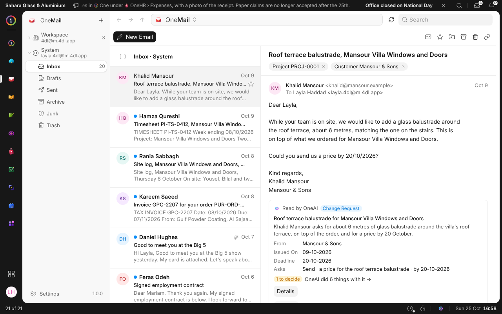

OneMail is where your company's email lives, and this is its first version.

- **An address for everyone.** The workspace has its own address, and each
  person gets one when they join.
- **Your other mailboxes, here.** Connect a mailbox at your company's domain
  with its address and password. If your workspace allows it, connect a
  private one such as Gmail too.
- **Shared mailboxes,** such as sales@, where you choose who reads and who
  may send.
- **Automation.** Rules sort, forward and answer new mail, and can ask OneAI
  to read it first.
- **Out of office,** which also turns on by itself while your leave is
  approved.
- **Signatures and templates.** A signature drawn from your details, and
  templates that fill in the record they are about.
- **Mail on your records.** A message about a customer, a supplier or an
  employee shows on their record, under Mail.
- **OneAI,** in the mailboxes you let it read: it summarises a conversation,
  drafts a reply and finds what waits for an answer.
- **Settings in one place,** each person seeing what their role allows.
