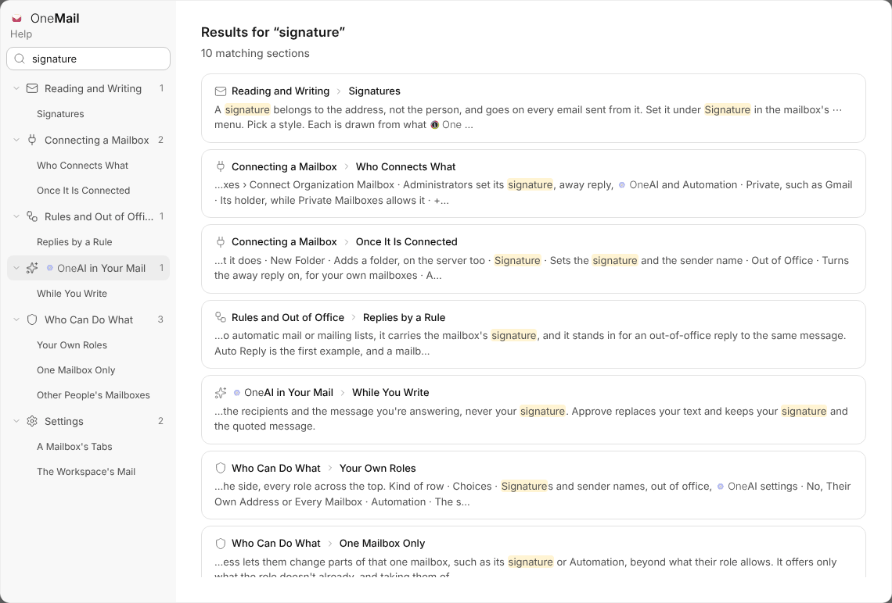

- **Search Help.** Type in the box at the top left and every page and
  section that mentions it is listed, with the words marked. Pick one to go
  straight there.
- **Pages with sections.** The open page lists its sections on the left, and
  the one you're reading is marked as you scroll.
- **Pictures and tables.** Each page shows the screen it talks about, and
  lists, roles and settings are set out in tables you can scan.
- **Who Can Do What** is a page of its own: the two roles, making your own,
  and access to one mailbox only.
- **What's New** lists each fix under the version it fixes.

