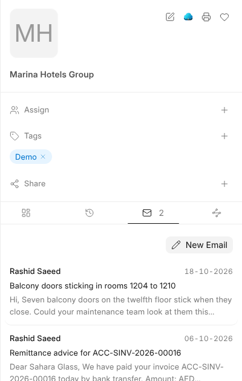

# Mail on Records

Mail about a customer, a supplier or an employee shows on their record, so
anyone opening the record sees the conversation.

## How Mail Finds Its Record

Each incoming message is linked on its own to:

| Linked to | When |
| --- | --- |
| A customer or supplier | The sender is one of their contacts |
| An employee or lead | They have the sender's address |
| What the conversation is linked to | An earlier message in it was linked |
| An invoice, order or other document | The message names it by its number |

The reading pane shows a message's links above it. **Link to Record** adds
another, and the × on a link removes it.

## On the Record

Customers, suppliers, leads, employees and documents have a **Mail** tab beside
their Files, with their conversations and **New Email**.

## Templates From a Record

**Use template** in the email window offers the templates for the record a
conversation is linked to, filled in from it. In a new message it offers
templates for any record. They're made under
[Settings › Mail Templates](settings).

> **A link never shows mail to anyone new.** A record's Mail tab and its
> activity list only the messages you could already open.
