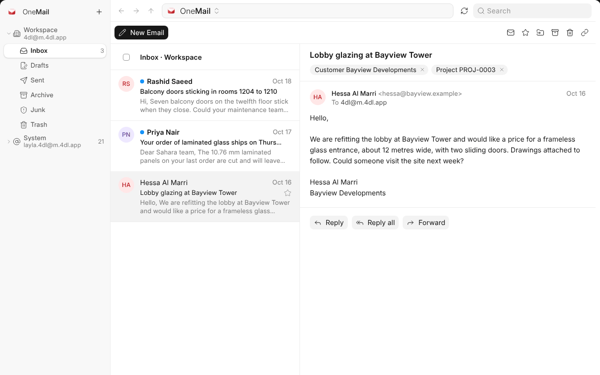

# What OneMail Is

OneMail is where your company's email lives. The workspace and every person in
it has an address, you can connect the mailboxes you already use, and every
message can be linked to the customer, supplier or employee it is about.

## The Window at a Glance

| Part | What it holds |
| --- | --- |
| **Mailboxes**, on the left | Every mailbox you can read, the workspace's first, then shared ones, then your own. Each opens to its folders. |
| **The list** | The conversations in the folder you picked, newest first. A blue dot means unread. |
| **The reading pane** | The conversation you opened, with the records it is linked to above it. |
| **The foot** | **Settings**, the play button that takes the tour, the question mark that opens this Help, and OneMail's version, which opens What's New. |

A short tour shows you each of these: press the play button at the foot of
the left pane, beside the cog that opens Settings.

## Where to Start

| I want to | Read |
| --- | --- |
| Know which addresses I have | [Your Addresses](your-addresses) |
| Bring in my Gmail or company mailbox | [Connecting a Mailbox](connecting-a-mailbox) |
| Read, search and write mail | [Reading and Writing](reading-and-writing) |
| Have mail sorted or answered on its own | [Rules and Out of Office](rules-and-out-of-office) |
| See a customer's mail on their record | [Mail on Records](mail-on-records) |
| Let OneAI read and file mail | [OneAI in Your Mail](asking-oneai) |
| Decide who may change what | [Who Can Do What](who-can-do-what) |
