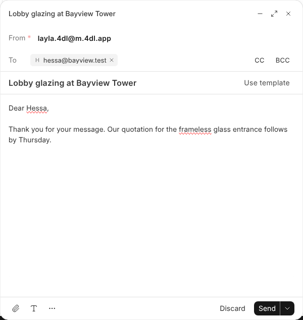
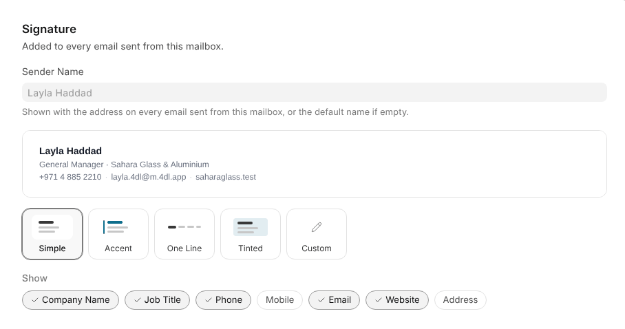

# Reading and Writing

**OneMail** in the dock opens every mailbox you can read. A connected mailbox is
checked every minute and the list updates on its own; **Refresh**, beside the
search box, checks now.

## Reading

Folders list conversations newest first. A conversation shows all its
messages, your replies among them, with older ones folded away.

> **Remote pictures stay hidden** until you click **Show pictures**, because
> loading them tells the sender you opened the message.

## Several at Once

Tick conversations, or pick them with Shift and Ctrl, then mark them read,
star, move, archive or delete them together. Moving, archiving and deleting can
be undone with **Undo** for a few seconds. Deleting from Trash is for good.

## Keyboard Shortcuts

| Key | Does |
| --- | --- |
| `j` / `k` | Next / previous conversation |
| `e` | Archive |
| `#` | Delete |
| `r` / `a` / `f` | Reply / Reply all / Forward |
| `s` | Star |
| `u` | Mark as unread |
| `c` | New email |
| `/` | Search |

## Searching

Words you type are found anywhere in a message. These narrow it down:

| Type | Finds |
| --- | --- |
| `from:ana` | Mail from Ana |
| `to:sales` | Mail to an address with "sales" in it |
| `subject:"price list"` | Mail with those words in the subject |
| `has:attachment` | Mail with a file attached |
| `is:unread`, `is:read`, `is:starred` | Mail in that state |

They combine: `from:ana subject:"price list" is:unread` finds unread mail from
Ana about the price list.

## Writing an Email

**New Email** starts one, and **Reply**, **Reply all** and **Forward** answer
the one you're reading. The email window opens in the corner, so you can
minimise it and keep reading.

| To | Use |
| --- | --- |
| Send it later | The arrow beside **Send** |
| Take it back | **Undo**, for a few seconds after sending |
| Ask for a read receipt, or a copy to yourself | **⋯** |
| Start from a template | **Use template** |

## Signatures

A signature belongs to the address, not the person, and goes on every email
sent from it. Set it under **Signature** in the mailbox's **⋯** menu.

- **Pick a style.** Each is drawn from what One already knows: the holder's
  name, job title and numbers, and the company's name, logo, colour, website
  and address. Pointing at a style shows it.
- **Show** picks which details appear.
- **Custom** is written by hand, starting from Simple's lines, and is never
  redrawn.

> **A style is drawn when it's saved**, so a new job title or company logo
> shows up the next time the signature is saved.

The signature sits under the message as it will be sent, with **Remove** to
leave it off one email. The company logo travels inside the email, so mail
apps show it without asking. A shared mailbox signs as the company, and only a
Workspace Administrator changes the workspace mailbox's signature.
