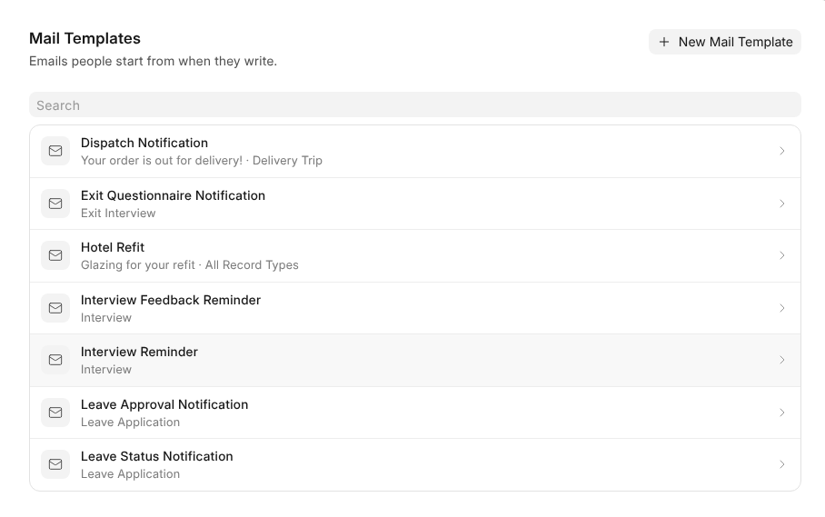

# Settings

**Settings**, at the foot of OneMail's rail, holds everything about your
mailboxes and, for administrators, the workspace's mail. Each tab has its own
**Save**, and the question mark at the top opens this Help.

> **You see only what your role lets you use.** Someone without a OneMail role
> beyond User sees **Mailboxes** alone; the workspace's areas below appear for
> those whose role reaches them.

## A Mailbox's Tabs

**Mailboxes** lists every mailbox you read. Opening one turns the sidebar into
its tabs, with **All Mailboxes** above them to go back.

| Tab | What you set | On which mailboxes |
| --- | --- | --- |
| **Signature** | The signature and sender name | All |
| **Out of Office** | The away reply | Your own |
| **OneAI** | What OneAI reads and does on its own | All |
| **Users** | Who uses it and who may send from it | Shared |
| **Connection** | Its password, or disconnecting it | Connected |
| **Automation** | Its rules | All |

> **Read-only isn't hidden.** Where your role can't change a tab, such as the
> signature on the address the workspace gave you, the tab still shows what is
> set. See [Who Can Do What](who-can-do-what).

**Sender Name**, at the top of **Signature**, is the name people see beside the
address. Left empty, mail from a person's own address goes out under their
name, and from a shared mailbox under whoever writes.

## The Workspace's Mail

Administrators also see these, and roles that reach other people's mail see
System and Organization Mailboxes.

| Area | What's there |
| --- | --- |
| **Setup** | **Company Domains**, each with its servers, found on their own for Google Workspace, Microsoft 365 and Zoho. Then **Default Incoming**, **Default Outgoing**, and the address notifications are sent from. |
| **Shared Mailboxes** | The workspace mailbox and every shared one. **Users** adds or removes people and turns **Send** on or off for each. |
| **System Mailboxes** | **Send From New Addresses**, whether the address a new person gets can send, then each person's address with its own **Send**. Changing the default never changes an address already given. |
| **Organization Mailboxes** | Every mailbox people hold at the company's domains, and **Connect Organization Mailbox** to connect one for somebody. |
| **Private Mailboxes** | Whether people may connect mailboxes anywhere else, such as Gmail. **Allowed Domains** limits them; leave it empty to allow any. |
| **Mail Templates** | Emails people start from. |
| **Roles** | What each role may do. See [Who Can Do What](who-can-do-what). |

A mailbox opened from System or Organization Mailboxes shows its Signature, Out
of Office, OneAI and Automation tabs.

## Mail Templates

A template opens in place, with **Save** and **Delete** at the top.

- **For** sets the kind of record it is written for. Then typing **/** in the
  subject or the message lists that record's fields; typing narrows them and
  Enter puts one in.
- **A table** asks which columns, with the item's name, quantity, rate and
  amount ticked, and is mailed as a table.
- **Preview** fills it in from the latest record of its kind, or one you pick,
  as it would be sent: 1,250.00 AED, not 1250.0.

> **A template a setting still sends** says **Used by**, such as the leave
> approval HR Settings sends, and can't be deleted until the setting names
> another.

A template written with code in it, as the apps' own are, opens as code so its
tags stay whole.
