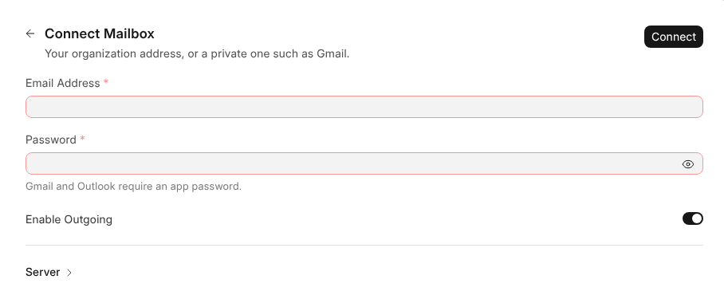

# Connecting a Mailbox

Any mailbox that speaks IMAP can be connected, and then works here with all its
folders.

> **Gmail and Outlook need an app password**, made in the account's security
> settings. Your usual password is refused.

## How to Connect

1. Click **+** beside {one_mail}'s heading, or **Connect Mailbox** in
   **Settings › Mailboxes**.
2. Enter the **Email Address** and **Password**. The page says what you may
   connect.
3. Leave **Enable Outgoing** on to send from it too.
4. Open **Server** only if the server isn't found on its own, or the login
   differs from the email address.

Connecting signs in to the incoming server, and with **Enable Outgoing** on to
the outgoing one, before anything is saved. A guessed outgoing server is tried
on its other usual port too.

## Who Connects What

| Mailbox | Who connects it | Where | Who else sees into it |
| --- | --- | --- | --- |
| **Organization**, at a company domain | Its holder, or an administrator for them | **+**, or **Organization Mailboxes › Connect Organization Mailbox** | Administrators set its signature, away reply, {one_ai} and Automation |
| **Private**, such as Gmail | Its holder, while **Private Mailboxes** allows it | **+** | Nobody, not even administrators |
| **Shared**, such as sales@yourcompany.com | A Workspace Administrator | **Settings › Shared Mailboxes › Connect Shared Mailbox** | The people added to it |

At a domain set up under **Setup**, people type only the address and password;
the server fields are hidden. An administrator can connect only a company-domain
mailbox for somebody else, never a private one. It then appears in that
person's mailboxes.

## Once It Is Connected

All its folders appear, Sent, Junk, Drafts and your own among them. Reading,
starring, moving, deleting and new folders happen on the mail server too, so
your phone stays in step.

A mailbox's **⋯** in the sidebar, or a right-click on it, has:

| Item | What it does |
| --- | --- |
| **New Folder** | Adds a folder, on the server too |
| **Signature** | Sets the signature and the sender name |
| **Out of Office** | Turns the away reply on, for your own mailboxes |
| **Automation** | Its rules, in the order they run |
| **Attachments in {one_cloud}** | Opens the folder its attachments are saved in |
| **Mailbox Settings** | All of the above in one place |

A folder you made has **New Folder**, **Rename** and **Delete**. Deleting it
moves its messages to Trash.

> **If a mailbox stops connecting**, usually because its password changed,
> whoever holds it is told **Mailbox Not Reachable**. Give it the new password
> under **Connection** in its settings.
