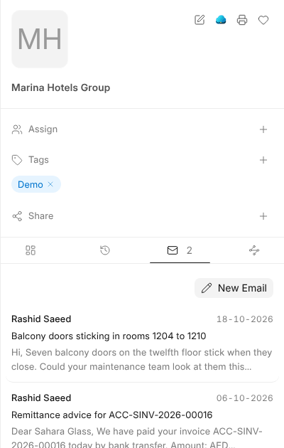
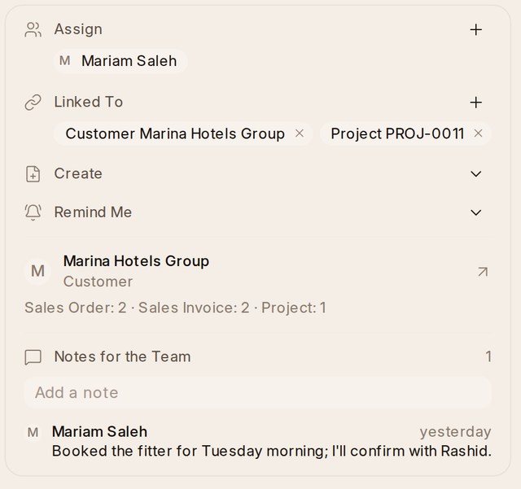

# Mail on Records

Mail about a customer, a supplier or an employee shows on their record, so
anyone opening the record sees the conversation.

## How Mail Finds Its Record

Each incoming message is linked on its own to:

| Linked to | When |
| --- | --- |
| A customer or supplier | The sender is one of their contacts, or writes from their address |
| An employee, lead or job applicant | They have the sender's address |
| What the conversation is linked to | An earlier message in it was linked |
| An invoice, order or other document | The message names it by its number |

A conversation's panel shows its links under **Linked To**. Its **+** adds
another, and the × on a link removes it.

## On the Record

Customers, suppliers, leads, employees and the documents people write about
have a **Mail** tab beside their Files, with their conversations and **New
Email**: quotations, orders, invoices, deliveries, receipts, requests for
quotation, payments and reminders, work orders and work sent to suppliers,
projects and tasks, leave, expense claims, interviews and job offers,
non conformances and quality actions.

## Who Wrote

Beside a conversation, the customer, supplier, lead, employee or applicant who
wrote it shows in the panel, with a count of what of theirs is still open:
deals and quotations, orders to deliver, invoices still to pay, issues and
projects, purchase orders, leave and claims. The count lists them, and each
opens its record.

On a narrow screen it's a
line above the mail that opens on a click. You see only what you could open
anyway.

## Records From a Mail

**Create**, in a conversation's panel, starts a lead, an opportunity, an issue, a task, a
non conformance or a purchase order, filled in from the mail: who wrote, the
subject and what they said, and the customer or supplier when {one} knows them.
Once saved, the conversation is linked to it.

## Templates From a Record

**Use template** in the email window offers the templates for the record a
conversation is linked to, filled in from it. In a new message it offers
templates for any record. They're made under
[Settings › Mail Templates](settings).

> **A link never shows mail to anyone new.** A record's Mail tab and its
> activity list only the messages you could already open.
