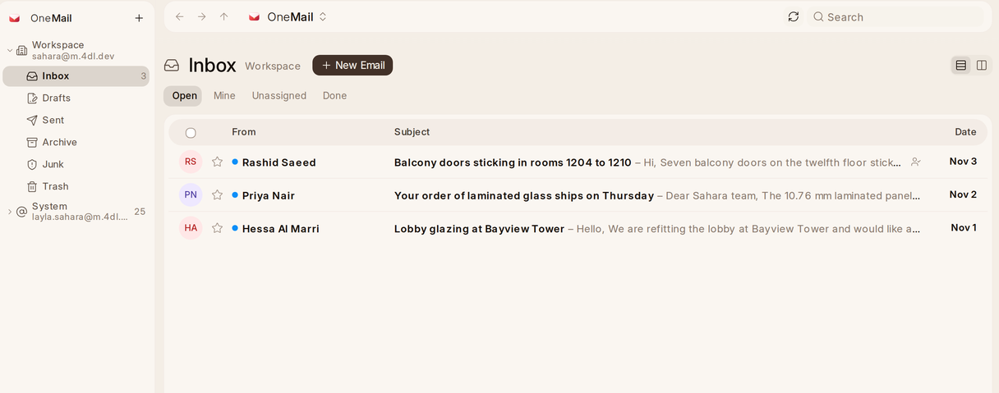

# What {one_mail} Is

{one_mail} is where your company's email lives. The workspace and every person in
it has an address, you can connect the mailboxes you already use, and every
message can be linked to the customer, supplier or employee it is about.

## The Window at a Glance

| Part | What it holds |
| --- | --- |
| **Mailboxes**, on the left | Every mailbox you can read, the workspace's first, then shared ones, then your own. Each opens to its folders. |
| **The list** | The conversations in the folder you picked, newest first, one to a line. A blue dot means unread. |
| **The conversation** | Opens in place of the list, with **Mark Done**, **Archive**, **Delete**, **Mark as unread**, **Star**, **Move to** and **Snooze** beside its subject and the back arrow to return. The panel on the right holds **Assign**, **Linked To**, **Create**, **Remind Me**, who wrote and the team's notes; on a phone it opens from the line under the subject. **Show Reading Pane**, at the far end of the heading, keeps the list and the conversation side by side instead. |
| **The foot** | The question mark that opens this Help, the play button that takes the tour, and {one_mail}'s version, which opens What's New. |

A short tour shows you each of these: press the play button at the foot of
the left pane, beside the question mark that opens Help.

## Where to Start

| I want to | Read |
| --- | --- |
| Know which addresses I have | [Your Addresses](your-addresses) |
| Bring in my Gmail or company mailbox | [Connecting a Mailbox](connecting-a-mailbox) |
| Read, search and write mail | [Reading and Writing](reading-and-writing) |
| Have mail sorted or answered on its own | [Rules and Out of Office](rules-and-out-of-office) |
| See a customer's mail on their record | [Mail on Records](mail-on-records) |
| Let {one_ai} read and file mail | [{one_ai} in Your Mail](asking-oneai) |
| Decide who may change what | [Who Can Do What](who-can-do-what) |
