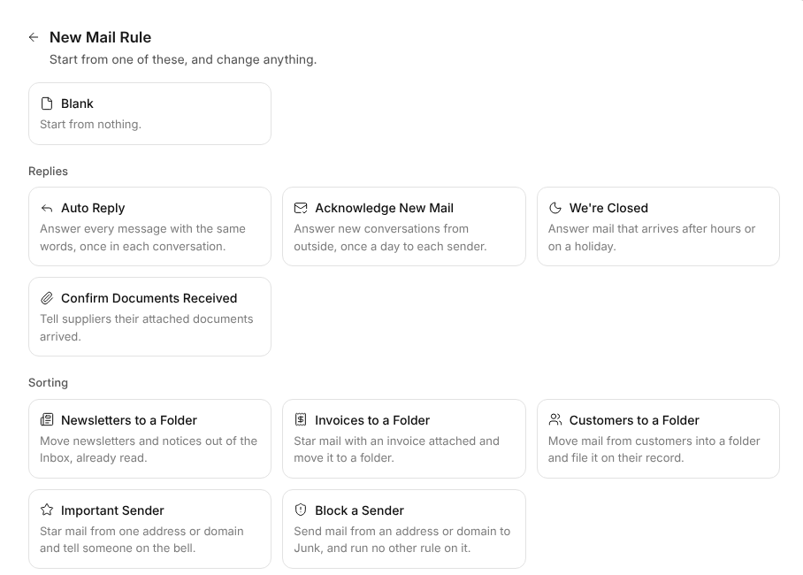
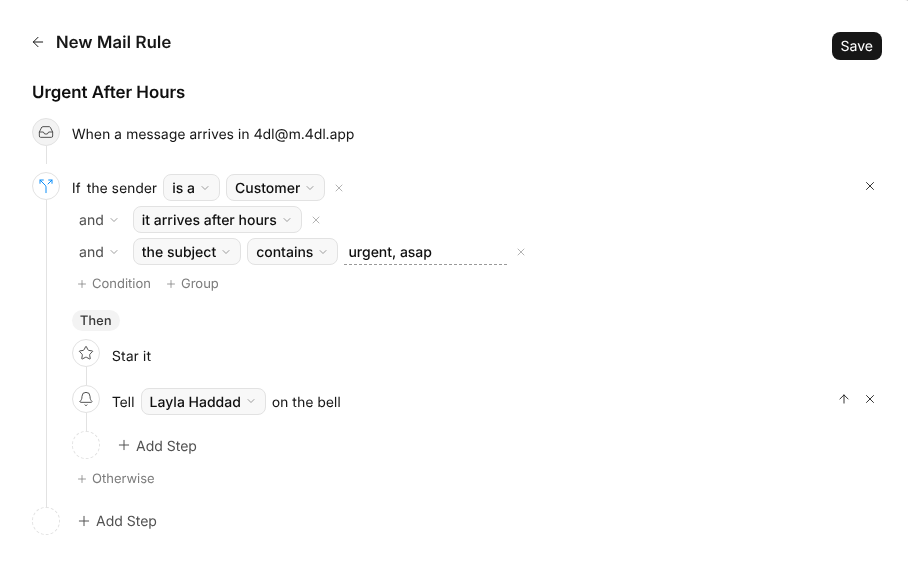
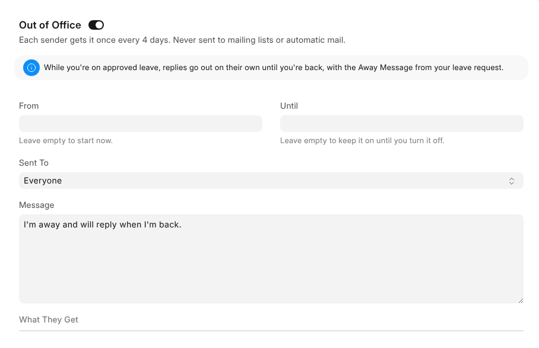

# Rules and Out of Office

Rules decide what happens to new mail as it arrives in the Inbox, the same way
every time. Out of Office answers while you're away.

## Rules or {one_ai}?

Both act on new mail without you, but they decide differently.

| | Automation | {one_ai} |
| --- | --- | --- |
| **Who decides** | You, in rules you write | {one_ai}, from reading each message |
| **What it does** | The same thing every time | Sorts junk, files mail, makes the records and tasks a message asks for |
| **Mails people outside** | Yes, a rule may reply or forward | Never |
| **Where it lives** | **Automation** in the mailbox's **⋯** menu | **{one_ai}** in the mailbox's settings |

> **Where both would act, the rule wins.** A record a rule made from a message
> is never made again by {one_ai}, and a message a rule moved out of the Inbox is
> left for {one_ai} to sort.

## Making a Rule

1. Open **Automation** in the mailbox's **⋯** menu and click **New Rule**.
2. Start from **Blank** or one of the examples.
3. Change anything, then **Save**.

The examples come in five groups and between them use every condition and
every action.

| Group | Examples |
| --- | --- |
| **Replies** | Auto Reply, Acknowledge New Mail, We're Closed, Confirm Documents Received |
| **Sorting** | Newsletters to a Folder, Invoices to a Folder, Customers to a Folder, Important Sender, Block a Sender |
| **People and Records** | Support Requests, New Leads, Tasks From Mail, Urgent After Hours, Assign New Conversations, Route by Subject |
| **Forwarding** | Auto Forward, Forward Supplier Bills, Forward After Hours, Forward Job Applications |
| **With {one_ai}** | Sort by Topic, Upset or Urgent, Answer From Their Records, Auto Reply in Their Language |

The last group only shows where {one_ai} may read the mailbox, and every example
that asks {one_ai} something carries its badge.

## How a Rule Reads

A rule reads as sentences down a line, top to bottom. Each chip is a choice:
click it to pick something else, or type in a blank.

A rule is made of three kinds of step.

| Step | What it does |
| --- | --- |
| **If** | Checks the message. Its conditions sit in groups, **All of These Are True** or **Any of These Is True**, and a group can hold another. It has **Then** steps, and **Otherwise** steps if you add them. With no conditions it matches every message. |
| **Ask {one_ai}** | Asks a yes-or-no question ("is it a complaint?") or picks one of your labels ("Quote Request", "Complaint"). Each answer has its own steps. |
| **An action** | Does something to the message. |

### What an If Can Check

| Condition | For example |
| --- | --- |
| Who it's from, or who it's to | the sender is ana@client.com |
| The subject, or any words in it | the subject contains "invoice" |
| The sender's domain | ends in @supplier.com |
| An attachment | it has one |
| A new conversation | it starts one |
| From outside | it comes from outside the workspace |
| Who the sender is | a customer, supplier, lead, contact or employee |
| When it arrives | after hours, or on a holiday, by the workspace's shift and holiday list |

### What a Rule Can Do

| Action | Note |
| --- | --- |
| Move to a folder, mark as read, star, move to Junk | Done on the mail server too, so your phone matches |
| Reply | In your own words, or written by {one_ai} and sent as it is, with a line saying an AI agent may have written it and it may be wrong |
| Forward | To any address |
| Assign, or tell someone on the bell | Anyone who uses the mailbox |
| Link to the sender's customer, supplier or lead | Shows on their record |
| Create a lead, issue or task | From the message |
| **Stop Here** | Keeps the rules after this one off the message |

> **Rules run in order, on new mail only.** Switch one off in the list to pause
> it. An example with a blank to fill, such as an address, can't be saved until
> it's filled, since a condition with nothing to look for would match all mail.

## Replies by a Rule

A rule's reply goes **once per conversation**, or once a day, week or month to
each sender. It is never sent to automatic mail or mailing lists, it carries the
mailbox's signature, and it stands in for an out-of-office reply to the same
message. **Auto Reply** is the first example, and a mailbox that answers by a
rule says **Auto Reply On** in the rail.

**Your own words** can use {sender_name} and {subject}, which fill in.

**{one_ai}'s words** go out as written, with no one checking first, so what you
type is an instruction, never the reply: "answer from their orders and say we
follow up within a day". A reply that still leaves a blank for a person to fill
is not sent at all. It needs {one_ai} on for the mailbox and counts against its
monthly limit.

### Answering From Their Records

Set to **reading their records**, {one_ai} may answer with what the customer
portal shows that sender, and nothing more:

- every open record of each customer or supplier the address is a contact of,
  such as quotations not yet ordered, orders not yet delivered and invoices not
  yet paid;
- the latest ten of the rest of each kind, and any the message names;
- one record in full, or older ones of a kind, if it asks while writing.

A customer writes "where is my order", never the order's number, so {one_ai} works
out which records the message is about and mentions only those.

> **Only from a verified sender.** A From line is free to write, so {one_ai} says
> nothing about records unless the receiving server confirmed the sender, kept
> on the message as **Sender Verified**.

## Asking for a Rule

On the address the workspace gave you, a rule is asked for rather than made.

1. **Request Rule**, build it, then **Send Request**.
2. It shows **Waiting for Approval**, and everybody who may change that
   mailbox's rules is told.
3. Approved, it runs and you're told. Declined, it's removed and you're told.

Changing a rule that runs asks again, and it pauses until approved. You can
delete a request while it waits.

## Asking {one_ai} for a Rule

You can also ask the {one_ai} panel, for example "put mail about soft drinks in
Beverages". It suggests the rule on a card, and when you approve it:

1. the folder is made if it doesn't exist;
2. {one_ai} starts reading the mailbox, for a rule about what mail says;
3. the rule is made;
4. for a rule by words, matching mail already in the Inbox can be moved too.

---

## Out of Office

Out of Office is on every mailbox of your own: the address the workspace gave
you and any you connected. Shared mailboxes answer by a rule instead. Everyone
sets their own, unless their {one_mail} role says otherwise.

| Field | What it does |
| --- | --- |
| **From** and **Until** | Set it up ahead of time. Leave From empty to start now, and Until empty to keep it on. |
| **Sent To** | Everyone, only people in the workspace, or them and the workspace's contacts |
| **Message** | Starts as the standard reply. **What They Get** shows it as the sender will, signed and under the mailbox's sender name. |

Each sender gets one reply every four days, and one again when a new time away
begins. Mailing lists, newsletters, other automatic replies and no-reply
addresses get none.

> **While it's on**, your mailbox says **Out of Office until …** in the rail and
> in **Settings › Mailboxes**, and anyone writing to you sees you're away, and
> who covers, above their message.

## On Leave

Every mailbox of your own answers on its own on each day of your approved leave
in {one_hr}, so nobody turns it on or off. The leave request says how:

| On the leave request | Does |
| --- | --- |
| **Away Message** | What the reply says. Left empty, it's the mailbox's own message, or that you're on leave and back on your next working day. |
| **Out of Office Replies** | Off means no replies for this leave. |
| **Covering Person** | Named in the reply for anything urgent. |
| **Covering Person Reads My Mail** | Lets them read your workspace address in {one_mail} until the leave ends, never send from it. They're told when it starts. |

The half day of a half-day leave gets no replies, since you're working too. A
cancelled leave stops the replies, and the covering, at once.

## Bounces

When mail to an address bounces for good, {one_mail} stops sending to it and marks
the message that bounced.
