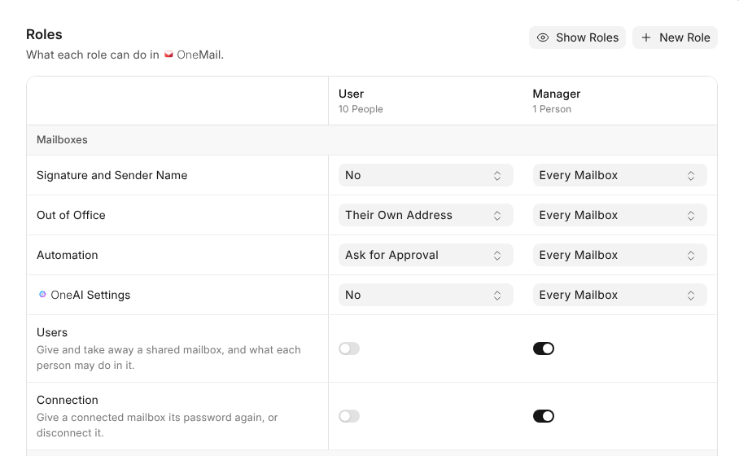

# Who Can Do What

What each person may change in {one_mail} is their {one_mail} role. A Workspace
Administrator sets it in **{access_center}**, opened from **Roles and Access** at
the end of {one_mail}'s settings, or on the person's page in **{account_center} ›
People**. Workspace Administrators can do everything.

## The Two Roles

| Role | Who has it | What they may do |
| --- | --- | --- |
| **User** | Everyone | Manage the mailboxes they connected, such as their Gmail. On the address the workspace gave them, set their own out of office and ask for rules, which a Mail Manager approves. |
| **Manager** | People you choose, often in HR or PR | Everything on every mailbox, as well as connecting shared mailboxes, the address policy and mail templates. |

## What Each Role Starts With

This is what {one_mail}'s roles hold when {one_mail} arrives in a workspace.
**Roles** in {access_center} changes any of it, and an update never undoes a
change you made.

{roles}

## Your Own Roles

A Workspace Administrator makes more roles under **Roles** in {access_center}.
It's one table: what {one_mail} lets a role do down the side, every role across
the top. **People** beside it shows everybody's {one_mail} role and changes it.

| Kind of row | Choices |
| --- | --- |
| Signatures and sender names, out of office, {one_ai} settings | **No**, **Their Own Address** or **Every Mailbox** |
| Automation | The same, or **Ask for Approval** |
| Users, connections, connecting shared mailboxes, the address policy, mail templates | A switch |

Each cell saves as it changes. **New Role** adds a column, a role's name
renames or deletes it, and **Show Roles** hides the columns you don't need. A
Brand role, for example, could keep every signature and nothing else.

## One Mailbox Only

On a shared mailbox's **Users** tab, each person shows their {one_mail} role, and
**Edit Access** lets them change parts of that one mailbox, such as its
signature or Automation, beyond what their role allows. It offers only what the
role doesn't already, and taking them off the mailbox takes it away too.
**On One Record** in {access_center} lists everybody given more on one mailbox,
and changes or takes it away there too.

## Other People's Mailboxes

Whoever's role reaches other people's mailboxes finds them under **System
Mailboxes** and **Organization Mailboxes**, and opens one to set its signature,
sender name, out of office, {one_ai} or Automation.

> **Private mailboxes stay private.** Nobody but their holder can see into a
> mailbox connected from Gmail or anywhere else outside the company, not even an
> administrator. Connecting a shared mailbox doesn't make it the connector's.
