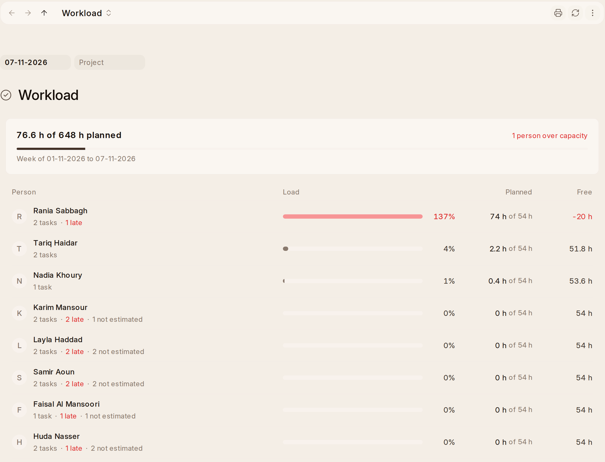

# Time

A project's **Timesheet** tab lists every hour on the project and its
sub-projects, newest first: the day, who,
the activity, the task (with the sub-project under it), the hours, and where
they stand. **Draft** is on a timesheet not yet submitted, **To Invoice** is
billable and not invoiced, **Invoiced** is on an invoice, and **Not Billable**
is cost only. **Group By** puts them under each person, activity, task or
sub-project, with their total over all its entries. They come grouped by
person, a few each, with **Show More** under each group. The newest 200 are
listed, and **Open Older Entries** opens the rest in the Timesheet list. Where nothing is billed, as on a Fixed Price
job, only drafts say where they stand. Click an entry to open its timesheet.

The figures:

- **Logged**: all the hours, against what the tasks plan (their Expected
  Time), or else the project's **Planned Hours**, with what's not submitted
  yet.
- **This Month**: this month's hours.
- **To Invoice** and **Invoiced**: on a project that bills hours, or one with
  a sub-project that does (it says which). **Invoice Time** is the button on
  **To Invoice**. On a project with sub-projects it invoices all their billable
  hours for the same customer on one invoice.

  On a Time and Materials job, **Invoice Time** also offers **Bill Costs**:
  what was bought for it and not billed yet (supplier bills' lines, stock
  issued to it and approved expense claims), one line each at cost plus the
  project's **Markup on Costs**, made out as the item you pick in **Bill
  Costs As**. A cost billed once isn't offered again, unless its invoice is
  cancelled. A Fixed Price job's costs are covered by its price and are never
  billed this way.
- **Time Cost**: what the hours cost at each person's cost rate, against the
  project's **Time Budget** if it has one, red once it's over. On a Fixed
  Price job this is how you see whether the team is burning more time than
  the price allowed.

A retainer shows this month's hours against its allowance instead.

Money shows only to those who may see time rates (Accounts Users). Everyone else sees the hours. Amounts are in the company's
currency.

**Log Time** asks for the day, the hours, the activity, and the task if there
was one. On a project with sub-projects it asks which one, and picking a task
picks its sub-project. The entry goes into your timesheet for the week, the
same one the timer on a task writes into, ready to submit with the rest.
Logging time on a task doesn't complete it; complete it when it's done.
Hours from before this week still in draft show in **Needs You** as **Submit
your timesheet**. On a project counted by attendance, the days come from
attendance and there's no Log Time.

Time on a project billed by the hour is billable, however it's written: Log
Time, the timer, OneHR or Data Import. Desk's timesheet form ticks
**Is Billable** as you pick such a project, and you can untick it. A row's
task must be on the row's project or one under it. A Time and Materials
invoice prints the hours it bills, under **Time Billed**: the day, the
activity, who, the hours and what they come to.

Whoever may read timesheets sees Time, and sees the entries they may read. A
project whose time isn't tracked has no Timesheet view, unless someone logged time
on it anyway.

## Days on Site

On a project counted by **Attendance on Site**, each day someone's attendance
is submitted and they were at the site, the day becomes a timesheet on the
project, made and submitted for them:

- **At the site** means one of their check-ins that day was inside the site's
  circle (or a clock place drawn on it). When check-ins have no position, their
  shift that day names the site.
- **The hours** are the attendance's working hours, or the standard working
  day from HR Settings (half of it for a Half Day).
- **The activity** is **Activity for Days on Site** in Projects Settings
  (**Site Work** to start with). Set its costing rate, or each person's
  Activity Cost, so the days carry their labour cost.
- **Billable** follows the kind: daywork on a Time and Materials project is
  billed, a Fixed Price project's days are cost.
- **Cancelling the attendance** cancels its timesheet, unless it's been
  invoiced.

HR keeps attendance for payroll as it is. A day that can't be written, such
as one whose hours overlap a timesheet the person already has, doesn't stop
the attendance. It's in the Error Log.

## Who Has Room This Week

**Workload** in the rail shows everyone on an open project's team, and
anyone else with open tasks, in a week. Someone with nothing planned shows
with all their hours free. It shows this week unless you pick a day in
another, and every project unless you pick one. The week it covers is named
above the table, and the cards above it give the team's **Capacity**,
**Planned** and **Free** hours and how many people are **Over Capacity**.
Each person shows:

- **Capacity (Hours)**: their working days that week, minus holidays and
  approved leave, times the working day set in HR Settings (**Standard
  Working Hours**, or 8 if it isn't set).
- **Planned (Hours)**: the hours still to do on their tasks that fall in the
  week. That's a task's **Expected Time** minus the time already logged on
  it, spread over the days from its start to its due date. Overdue work counts
  in full this week. A task assigned to two people counts half for each.
- **Free (Hours)** and **Load (%)**: red once they're over.
- **Tasks** and **Late**, how many are past their due date. Click either for
  the list.
- **Not Estimated**: how many of their tasks that week have no Expected Time.
  Click it for those tasks, to fill them in.
  The hours are only as good as the estimates, so a light week with five
  unestimated tasks isn't really light.

The busiest come first, then whoever has the most late tasks. Give tasks an
**Expected Time** and a date and the figures follow. You only
see the tasks you can see, and the teams of the projects you can open. It
draws itself again when a task, a timesheet or a leave changes. OneAI offers
**Who has too much on this week?** here.
