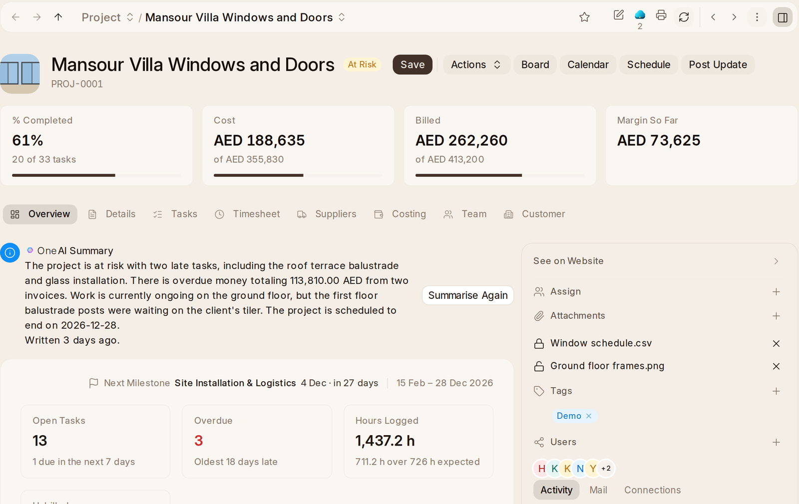

# A Project's Page

Opening a project opens its form. At the top are its picture, name, status
and health, and four figures:

- **% Completed**: how much of the work is done, with how many of its tasks.
- **Cost**: what's been spent, out of its estimated cost, red when it's over.
- **Billed**: what the customer has been invoiced, out of what they ordered.
- **Margin So Far**: what's been billed less what's been spent, red below
  zero.

At the top of the panel beside it are the customer and the sales order the
project was won with, each opening its own page.

Beside the name are the project's buttons (see Buttons below), and on the
right who it's assigned to, its attachments, tags, sharing and likes, with
its **Activity**, **Mail** and **Connections**.

## Its Tabs

- **Overview**: how the work is going, then what a project of its kind is run
  by (see Overview below).
- **Details**: its name, customer, status, health, manager, kind and dates.
- **Tasks**: every task, with its status, priority, dates and progress,
  changed in place. **Add Task** adds one. **Board** at the top shows them in
  columns by status, and **Schedule** on a timeline.
- **Timesheet**: every hour logged on the project and its sub-projects, with
  **Log Time**. Shown when the project counts time or has some.
- **Suppliers**: each subcontract as a card, the bills and what's bought for
  the project. Shown on a Fixed Price project, and on others once they have an
  order.
- **Costing**: the money, both sides, then the customer's invoices and the
  costing fields (see Money below).
- **More Info**: the team, then the members and contacts.
- **Customer**: the project's priority, type, department, task prefix, how
  its % Complete is measured, and its notes.
- **Progress updates**: when the team is asked how it's going.

A tab with nothing filled in stays out of the way until you choose **Show
Empty Fields**. The money on **Costing** shows to whoever may see the
documents behind it, and the customer's invoices to whoever may read
invoices.

## Overview

The top of the Overview is how the work is going: the next milestone and the
dates, **Open Tasks**, **Overdue**, **Hours Logged** and **Unbilled**, planned
against completed, tasks by status, what needs attention, open tasks by
person and profitability.

Under it is what the project's kind is run by:

- **Fixed Price**: **Work and Billing** puts the work done beside what's
  billed and paid: what the work done is worth but isn't invoiced yet (with
  **Bill Progress**) or what's invoiced ahead of it, what the customer **Owes**
  and how much of that is overdue or retention, anything **Paid in Advance**
  and when they were last billed. Then the **Orders**, the **Quotations**, the
  **Budget** (each cost type's spent, on order and left, with any over its
  budget listed under the chart) and the **Milestones**.
- **Time and Materials**: **Not Invoiced Yet** by person, with **Invoice Time**.
- **Retainer**: **Months**, each saying whether it's invoiced and how that
  invoice stands.
- **Internal**: the **Milestones** and what's **Due Soon** in the next two
  weeks.

Then its **Subcontracts**, **Retention** and **Contracts** (with **Draw Up
Contract**). On the right are **Needs You**, its **Updates**, the hours **By
Person** and **By Activity**, **Who's On It** and its **Sub-projects**.

**Needs You** lists what needs someone now beyond its tasks, which are under
Needs Attention above: cost types over budget (on a Fixed Price project
they're in **Budget** instead), bills drafted by Bill Progress to check,
supplier bills to pay and customer invoices to chase that are past due, and
what's still owed once the project is completed. What's past due is worked
out from what's still owed, earliest payment first, so retention not yet due
never counts.

**Sub-projects** starts with **Main**, the project's own work without what's
under it: what's ordered on it and how much is billed, and how far its own
tasks are. Then come the projects directly under this one, each with its kind,
when it's due or how late, who runs it and how far it's done, and what's
ordered and billed or spent against its budget. A red dot marks one that's
late, Off Track or over budget, and an amber one At Risk. **Show All** lists
them all when there are more than it shows. **Add Sub-project** starts a new
project under this one for the same customer.

## Money

**Costing** starts with the money for the project and its sub-projects: the
**Forecast**, the **Customer**'s side (ordered, delivered, invoiced, paid and
retention held) and the **Cost** side (ordered, received, billed, paid, time,
stock used and expense claims), then each **Cost Type** against its budget.
**Issue Stock**, **Return to Store** and **New Expense Claim** are on it. Then
the customer's **Invoices**, with what's paid and what's still owed.

## Status

A project is **Open**, **On hold**, **Completed** or **Cancelled**.

- A project completes itself when its last task is done, and opens again
  when a new task is added. **On hold** and **Cancelled** stay as you set
  them.
- Saving a project as **Completed** or **Cancelled** while tasks or
  sub-projects are still open asks first, and closes them with it. Say no
  and it stays as it was.
- A project whose tasks are all done can't be opened again until it has a
  new task.
- Once completed, its manager is told what's still owed.

**Health** is separate: how an open project is going, set by its people.

## Buttons

The project's main button is the kind's:

- **Make Order** on a Fixed Price project with one open quotation.
- **Add Contract** on a Fixed Price project for a customer with no contract
  or quotation yet.
- **Bill Progress** on a Fixed Price contract.
- **Invoice Time** for Time and Materials.
- **Invoice Month** for a retainer.
- **Post Update** otherwise, and whenever your update is asked for today.

**Board**, **Calendar** and **Schedule** show its tasks. **Actions** has
**Post Update**, **Ask for Updates**, **Quote Extra Work**, **Add from
Template**, **Save as Template** and **Group Under New Project**. Each shows
only to whoever may do what it does.

## Activity

**Activity** on the right is what happened on the project and its
sub-projects: what was changed, the comments, each update, the documents made,
submitted and cancelled for it, the tasks added and completed, and the hours
logged each week. Mentioning someone in a comment who can't open the project
asks whether to add them to it first.

## Photos and Videos

Every project's folder in {one_cloud} (**Records › Project ›** the project) has a
**Featured Media** folder. Put the project's best photos and videos in it:

- They're shown on the customer's portal, the cover first and then each in
  turn: a photo for a few seconds, a video muted to its end. Someone whose
  device asks for less motion gets the photos still.
- The newest photo is the project's **cover**, shown wherever the project has a
  picture.
- Anyone with the link to one can open it, so they can go on a website too.
  Put nothing there that isn't meant to be seen.

Only photos and videos go in. Drag a file from the project's folder into
Featured Media to show it, or back out to stop showing it. A file taken out
needs a sign-in to open again. Whoever may change the project may change its
Featured Media; whoever may see the project sees it.

## Documents on a Project

Every document about a project names it:

- **Customer**: quotations, sales orders, delivery notes and sales invoices.
- **Suppliers**: material requests, requests for quotation, supplier
  quotations, purchase orders, purchase receipts and purchase invoices.
- **Work**: tasks, timesheets, updates, expense claims and stock used.
- **Payments**: payments in and out.

Set the project once. A document made from another takes its project, so an
order made from a quotation names the quotation's project. A line with no
project takes the document's, and a document with no project takes its
lines' if they all name the same one.

A payment made on its own, or for several invoices at once, takes the
project its invoices and orders all name. A new quotation, sales order,
delivery note or sales invoice for a customer with one open project names
that project, however it is made. With more than one, pick it.

Each document a project hands on says the project at the top, by name, and
opens it: the quotation's deal, the order, the invoice, the bill, the
purchase order, the stock entry, the expense claim and the contract.

**Connections** on the right lists them in those four groups, and **+** next
to one starts it on the project.
