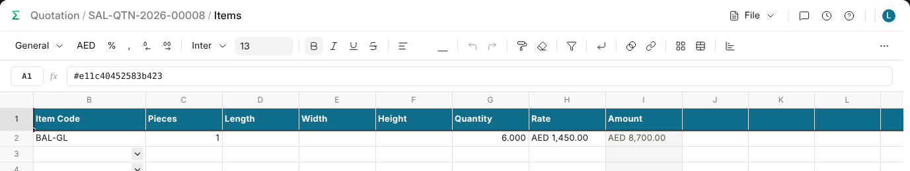

# A Record's Table

A table on a record, such as a quotation's items, opens as a workbook: a line
for each row and a column for each column the table shows.

## Opening It

Under every table on a saved record, beside **Add row**, is **Open in a
workbook**. The first time, it makes a workbook kept on the record; after
that the same button opens the same one. Its columns are the ones the table
shows on the form, so choose others with the table's gear before you open it
the first time.

## Changing It

Change a cell, add a line or delete one, and the record saves itself a moment
later. Amounts, totals and anything else the record works out come back into
the sheet. A new line needs only what the record can't work out, such as the
item.

The record checks everything as if you had typed it on the form. When it
refuses, the reason shows at the top, the cell it is about is tinted with a
red corner, and the record keeps what it had until the sheet is right. A name
that isn't a record yet offers to make it.

## What Stays Yours

A formula is fine anywhere in the first sheet; the record gets what it comes
to. The other sheets are yours, and the first can read them. The header and
the columns the record works out are locked, and a list column offers its
choices.

When somebody changes the table on the form while the workbook is open, the
first sheet is drawn again in place, formulas kept. Once the record is
submitted, the first sheet can only be read.

## Who Can Open It

Whoever may read the record may open its workbook, and whoever may change the
record may change it.
