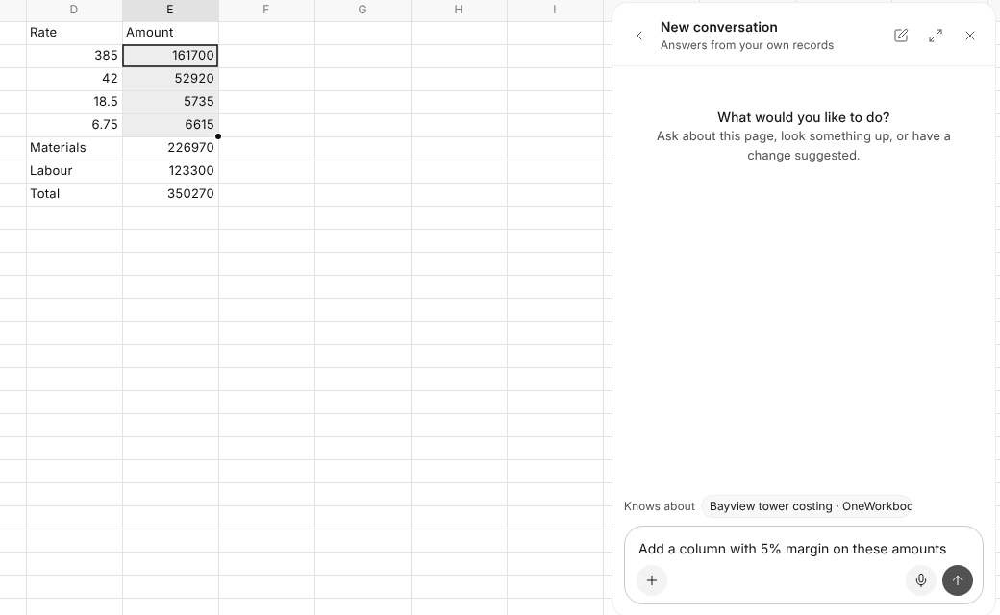

# Asking OneAI

When OneAI is on, ask it in its own panel at the bottom right, as anywhere
else. On a workbook it already knows which workbook is open, its sheets, and
the cells you have selected with what they hold.

## What to Ask

| Ask | What happens |
| --- | --- |
| "Total this column" | A card that writes the formula. |
| "A margin formula in F2:F5, and make the header bold" | A card that writes the cells and their formatting. |
| "Leave a note on D14 that the rate is from June" | A card that leaves the note. |
| "Make me a workbook for this week's deliveries with a total" | A card that makes a new workbook. |
| "What does the aluminium sheet charge for powder coating?" | An answer, read from the workbook. |

Nothing changes until you approve the card, and an open copy of the workbook
reloads when you do. OneAI reads formulas as they are written, not what they
work out to, and only workbooks you may open.

## A Record's Table

OneAI never writes into a record's table sheet: ask it to change the record
instead.

Each question uses credits like any other. An administrator can turn OneAI
off for OneSheet in AICenter.
