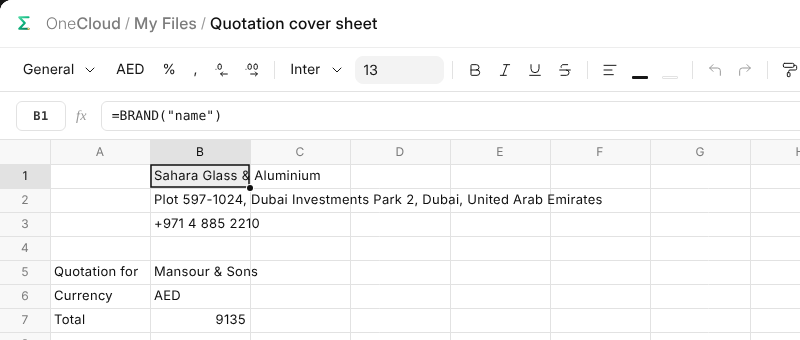

# Branded Sheets

A sheet can carry the business and the record it is for, kept up to date.

## The Business

`=BRAND("name")` reads the business's name, and so do "address", "phone",
"email", "website", "tax_id", "currency" and "colour". `=IMAGE(BRAND("logo"))`
draws the logo in the cell, fitted to it.

## A Record

`=RECORD("company")`, or any other field, reads the record a table's workbook
belongs to, as its form shows it; in any other workbook it is blank.
`=FIELD("Project", E1, "status")` reads a field of any record you may open,
named in a cell: pick a project in E1 and the cells that read it fill in.

## Lines That Fill Themselves

A sheet can say which formulas each of its lines gets, as an Excel table's
calculated columns do: type an item on a new line and its area, prices and
totals appear. Nothing is laid out before it is used, and the totals over the
header sum the whole column, however long it grows.

## A Record's Look

A record's table sheet is formatted when it is made: the header in the
business's colour, money in the record's currency, numbers to the field's
decimals, and what the record works out in grey. Formatting it yourself
afterwards stays.
