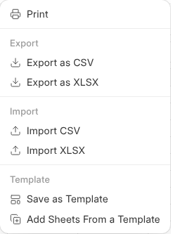

# Excel and CSV Files

A workbook is an Excel file wherever it leaves One, and an Excel or CSV file
in OneCloud opens in OneWorkbook.

## Opening One

An Excel or CSV file in OneCloud opens in OneWorkbook, with its sheets,
formulas, number formats and merged cells. What you change is saved into the
same file a minute after you stop, and again when you leave, so downloading
it or opening it in Excel gets it as it is now. What it held before is kept
under **Versions** in OneCloud. A CSV keeps only the first sheet.

Put in a new version of the file and it is read in again the next time it
opens.

## Exporting and Importing

**File › Export as CSV** or **Export as XLSX** saves a copy to your computer,
and **Import CSV** or **Import XLSX** brings one in. In OneCloud, right-click
a workbook › **Download as Excel** or **Download as CSV**.

## On a Network Drive

On a network drive, through a link and attached to a mail, a workbook is an
Excel file, such as "Glass prices.xlsx". Excel, LibreOffice and Numbers open
it with its formulas, formats, merged cells and column widths. A formula only
OneWorkbook knows, such as BRAND or FIELD, is written as the value it last
showed.

Save it from Excel and the values and formulas come back into the workbook,
its own formatting stays, and what it was before is kept in Version History.
A record's workbook opens read only on the drive.
