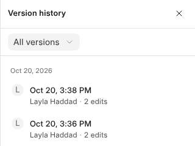

# History and Templates

The clock at the top opens Version History, and **File** keeps templates.

## Version History

Version History lists the workbook as it stood along the way, newest first,
with who changed it.

- Click a version to see it. **Restore** makes it the workbook again, and the
  versions after it stay.
- **Name** a version to keep it; named versions are never thinned out.
- **Make a copy** puts that version in a new workbook beside this one.
- Right-click a cell › **Cell history** shows every change to that cell, with
  its value before and after.

Versions are taken as you save, then every 25 edits or half a minute. Older
ones are thinned as they age: all from the last day, one an hour for a week,
one a day for a month, one a week for three months.

## Templates

**File › Save as Template** keeps a copy in OneCloud › Workbook Templates for
everybody in the business to start from: **New › Workbook** then asks which
template to start from. Who may keep templates is set in **Roles**; see
[Who Can Do What](who-can-do-what).

**File › Add Sheets From a Template** adds a template's sheets, such as a
costing sheet, beside the ones the workbook has. A sheet whose name is taken
gets a number after it.

A template is its own sheets and nothing else. Saved from a record's table,
it keeps the sheets beside the table and leaves the table out.
