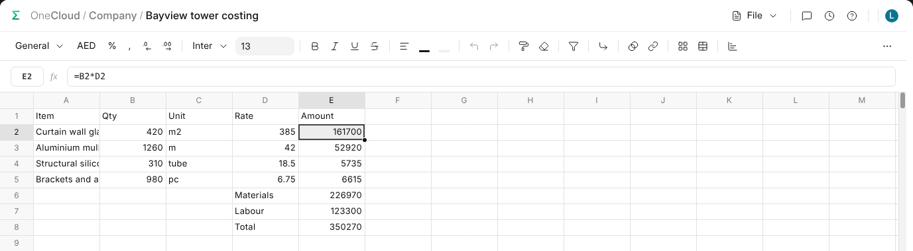

# What OneWorkbook Is

OneWorkbook is the business's spreadsheet: sheets, formulas, formatting,
charts, pivot tables and notes, in a workbook kept in OneCloud with the rest
of your files and opened by anybody it is shared with.

## A New Workbook

In OneCloud, open the folder it belongs in and choose **New › Workbook**,
blank or from a template. It opens straight away; click its name at the top
to rename it. It is moved, copied, shared and deleted in OneCloud like any
file.

Everything is saved as you type: **Saving…** and **Saved** beside the name
say where it stands, and if a save fails, **Retry** sends it again.

## Finding Your Way

| You see | What it is |
| --- | --- |
| **The path** | Where the workbook is kept. Each step is a way back, and OneWorkbook's mark goes one step back. |
| **The bar** | Number formats, fonts, colours, borders, filters, charts and pivot tables. |
| **The formula bar** | What the cell you are on holds. See [Working in a Workbook](working-in-a-workbook). |
| **File** | Print, export, import and templates. |
| **The speech bubble, the clock and ?** | Notes, Version History and the keyboard shortcuts. |
| **The tabs** | The workbook's sheets, at the foot. |

A workbook left for another screen waits on the bar under its title, after
the date. Click it to come back, or × to drop it; the bar remembers the last
five you left, on every device you sign in on.
