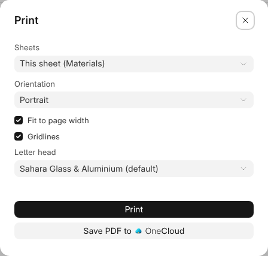

# Printing

**File › Print** prints this sheet or every sheet under the business's letter
head, drawn as it looks: the numbers as they show, colours, borders, merged
cells, column widths and pictures.

## The Choices

| Choice | What it does |
| --- | --- |
| **Sheets** | This sheet, or every sheet. |
| **Orientation** | A sheet wider than a portrait page starts on its side. |
| **Fit to page width** | Shrinks a wide sheet to the page. Without it, the columns that don't fit print on the next pages. |
| **Gridlines** | Can be left off. |
| **Letter head** | The workspace's default, another, or none. |

Hidden rows and columns are not printed.

## Keeping the PDF

**Print** opens the PDF in a tab of its own, to print or save from there.
**Save PDF to OneCloud** keeps it beside the workbook; a record's workbook has
**Attach PDF to** the record instead.
