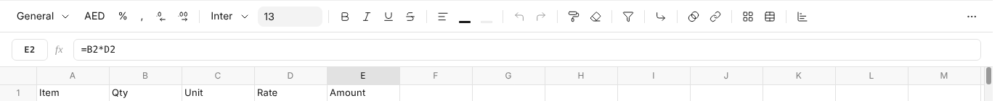

# Working in a Workbook

Type into a cell, or into the formula bar above the grid.

## Formulas

A value starting with = is a formula, such as `=SUM(B2:B5)` or `=B2*D2`. A
formula can read another sheet, such as `=Labour!D5`. A formula that works
out to an error, such as #VALUE! or #DIV/0!, reads red with a red corner, and
selecting it says in plain words what is wrong.

A formula that reads a whole column fills the cells below it, one line for
each line there: `=Costing!A4:A` puts Costing's column A here, from line 4 to
its last line. If something is typed where it wants to go, it shows #SPILL!
until that is cleared.

## Sheets

**+** at the foot adds a sheet. Right-click a sheet's name to rename, copy,
colour, hide or protect it. A colour is drawn as a band along the tab's foot.

## The Bar

The bar formats numbers, text and cells, merges cells, adds borders, filters
and sorts, and inserts charts and pivot tables. The currency button offers the
workspace's currency first, and Ctrl+Shift+4 applies it. A number format can
show a zero as blank.

## Notes and Shortcuts

**Notes**, the speech bubble, lists every note in the workbook; Shift+F2 adds
one to the cell you are on. **?** lists the keyboard shortcuts.

## Working Together

Everyone with a workbook open sees the others' changes cell by cell, without
saving or reloading. Their faces sit at the top right, and each person's
selection shows in the grid in their colour. Somebody who may only read sees
**View only** at the top, and the changes as they happen.
