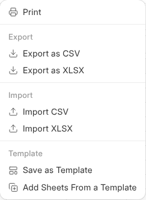

# Excel and CSV Files

A workbook is an Excel file wherever it leaves {one}, and an Excel or CSV file
in {one_cloud} opens in {one_sheet}.

## Opening One

An Excel or CSV file in {one_cloud} opens in {one_sheet}, with its sheets,
formulas, number formats and merged cells. What you change is saved into the
same file a minute after you stop, and again when you leave, so downloading
it or opening it in Excel gets it as it is now. Only the cells you changed
are written: the file keeps its fonts, colours, borders, comments, data
validation, conditional formatting, tables and pictures. What it held before is kept
under **Versions** in {one_cloud}, and saves within 10 minutes of each other
are one version. A CSV keeps only the first sheet.

Put in a new version of the file and it is read in again the next time it
opens.

## When Something Would Be Dropped

A few things in an Excel file change or go when it is saved here: charts,
slicers, shapes and text boxes, sparklines, form controls and connections to
outside data. When the file has one of them, a bar over the sheet names it,
and your changes stay in the workbook until you choose:

| Button | What it does |
| --- | --- |
| **Save Over Original** | Saves into the Excel file and drops what the bar names. The file as it was is kept under **Versions**. |
| **Save as Copy** | Saves a new Excel file beside it and goes on in the copy. The original stays as it was. |

A file with macros (.xlsm) or in the older Excel format (.xls) opens
read-only: open it in {oneos} to change it. While somebody has the file open in
{oneos}, it opens read-only here and says who.

## Exporting and Importing

**File › Export as CSV** or **Export as XLSX** saves a copy to your computer,
and **Import CSV** or **Import XLSX** brings one in. In {one_cloud}, right-click
a workbook › **Download as Excel** or **Download as CSV**.

## On a Network Drive

On a network drive, through a link and attached to a mail, a workbook is an
Excel file, such as "Glass prices.xlsx". Excel, LibreOffice and Numbers open
it with its formulas, formats, merged cells and column widths. A formula only
{one_sheet} knows, such as BRAND or FIELD, is written as the value it last
showed.

Save it from Excel and the values and formulas come back into the workbook,
its own formatting stays, and what it was before is kept in Version History
as **Before an Excel save**. If the Excel file had something the workbook
doesn't keep, such as comments or charts, a bar says so the next time it
opens.
A record's workbook opens read only on the drive.
