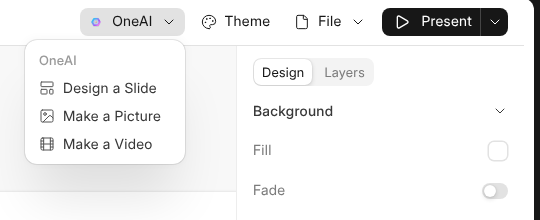

# Asking OneAI

When OneAI is on, **OneAI** in the head makes three things from a sentence.
Nothing it makes is kept until it is on your slide, and each request uses
credits like any other.

| Ask | What happens |
| --- | --- |
| **Design a Slide** | A new slide after the one you are on, laid out in your business's colour. Everything on it can be changed like anything else. |
| **Make a Picture** | A picture on this slide. |
| **Make a Video** | Takes a few minutes. It arrives on a new slide at the end, and you are told when it is there, or that it could not be made. |

**Make a Picture with OneAI** is in OneWriter too, in the menu that adds a
picture to a document.

An administrator can turn OneAI off for OneSlide in AICenter.
