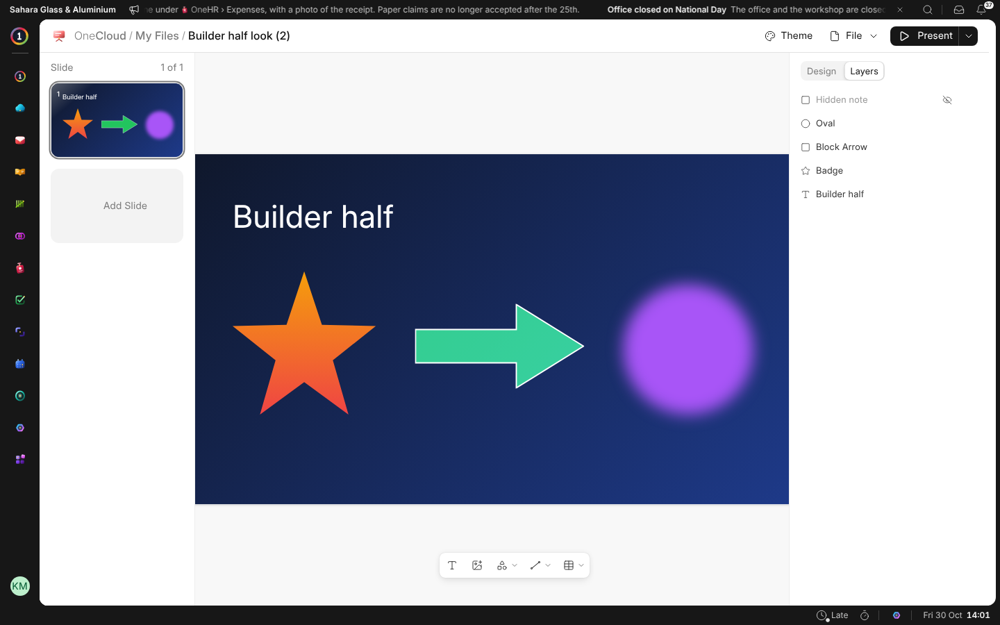
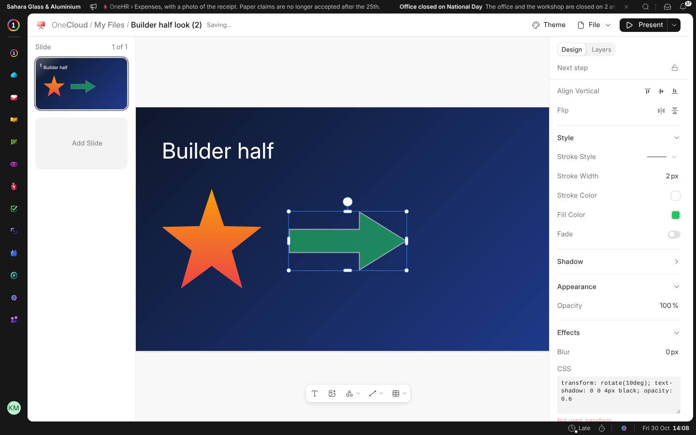

# Design and Layers

The panel has two tabs at the top: **Design**, for whatever you chose, and
**Layers**, for everything on the slide.

## Layers

**Layers** lists what is on the slide, the top first. Click one to choose
it, double-click it to give it a name, and drag it up or down to put it in
front of or behind the others. Its eye hides it and its lock keeps it from
being moved. A hidden element is not shown in the editor, the slideshow, a
PDF or on a screen.

## Fades

Any fill, and a slide's background, can **Fade** into a second colour. Turn
on **Fade**, then choose the colour it fades to and the angle it runs at.

## Effects

**Effects** blurs anything. Its **CSS** box takes CSS for the rest: rounded
corners, blend modes, text shadows, clip paths. What the box can't use is
listed under it as **Not used**. Where an element stands, its size and its
turn always come from the panel above.
