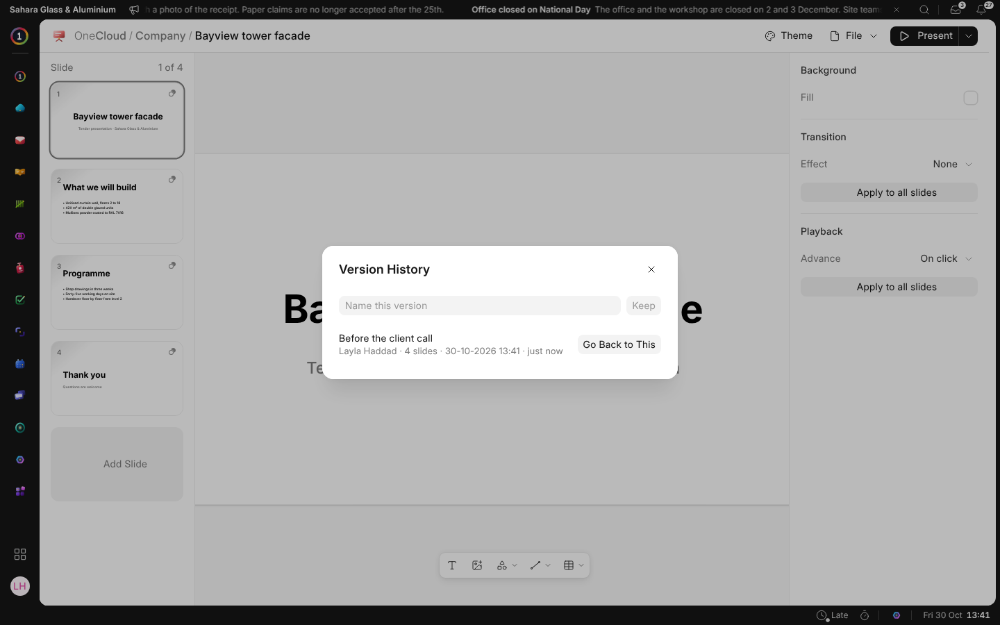

# History, Templates and PDF

Everything here is under **File** in the head.

## Version History

**Version History** lists what the presentation was, a version for every ten
minutes of work, newest first. Name a version to keep it by that name.
**Go Back to This** puts the slides back as they were, and keeps what they
were just before, so going back can be undone too.

## Templates

**Save as Template** keeps a copy in OneCloud › Presentation Templates for
everyone in the business to start from: **New › Presentation** offers it, and
**Theme** lists it beside Light and Dark. Who may keep templates is set in
**Roles**; see [Who Can Do What](who-can-do-what).

## Export as PDF

**Export as PDF** draws every slide as it looks on the screen, a page each,
keeps the PDF in OneCloud beside the presentation, and opens it.

## On a Record

A record's **Files** tab is OneCloud, so **New › Presentation** there files
the presentation on the record. Whoever may open the record may open it, and
its PDF is kept on the record too.
