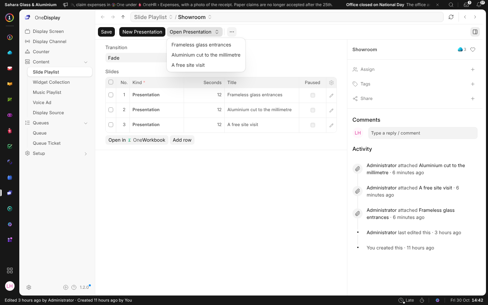
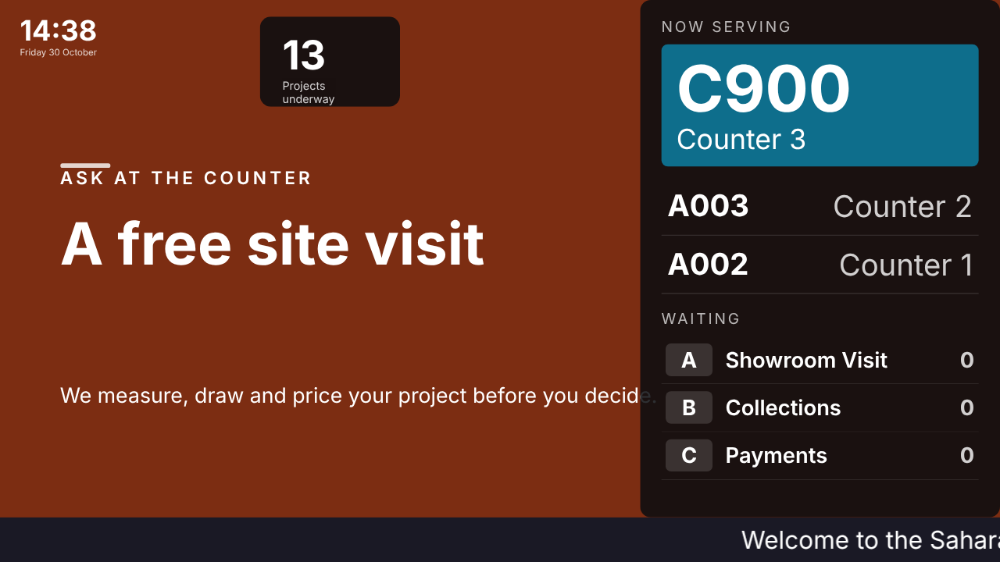

# On a Screen

A OneDisplay slide playlist plays presentations. Each row of it links one,
and every slide of that presentation plays on the screens in turn.

## From a Playlist

**New Presentation** on a playlist makes a presentation kept with the
playlist, and opens it. **Open Presentation** opens one the playlist already
plays. Each slide stays up for its own **Advance** time, or for the row's
**Seconds** when it has none.

## When Screens Change

What you change in the presentation is on the screens the next time they
look, without anyone touching them. A hidden element is not shown, and
pictures and videos play as they do in the editor.
