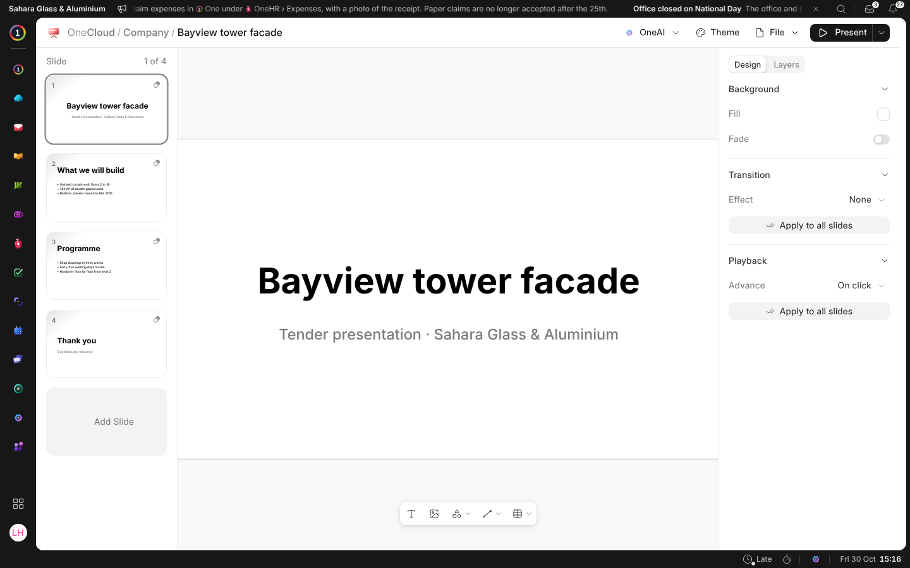

# What OneSlide Is

OneSlide makes presentations: a tender pitch, a monthly review, the slides a
screen in the showroom plays. A presentation is a file in OneCloud, kept
beside everything else the business has, and opened by anybody it is shared
with.

## A New Presentation

**New › Presentation** in OneCloud makes one in the folder you are in and
opens it on its title slide. Click a presentation in OneCloud to open it
again. It saves itself as you work: the head says **Saving…** and then
**Saved**.

The path at the top says where the presentation is kept, and each step is a
way back. Click its name there to rename it.

## Finding Your Way

| You see | What it is |
| --- | --- |
| **The slides** | Down the left. See [Working on Slides](working-on-slides). |
| **The bar under the slide** | Text, pictures and videos, shapes, lines and tables. |
| **The panel** | On the right: whatever you chose, or the slide itself. See [Design and Layers](design-and-layers). |
| **File** | Version History, Save as Template and Export as PDF. See [History, Templates and PDF](history-and-pdf). |
| **OneAI** | Designs a slide, or makes a picture or a video. See [Asking OneAI](asking-oneai). |
| **Present** | Plays the presentation from this slide or from the start. |

A presentation also plays on a screen: see [On a Screen](on-screens).
