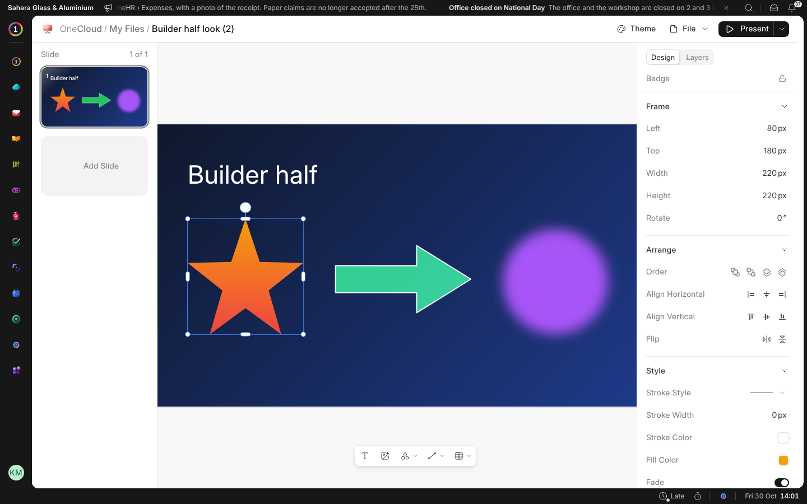
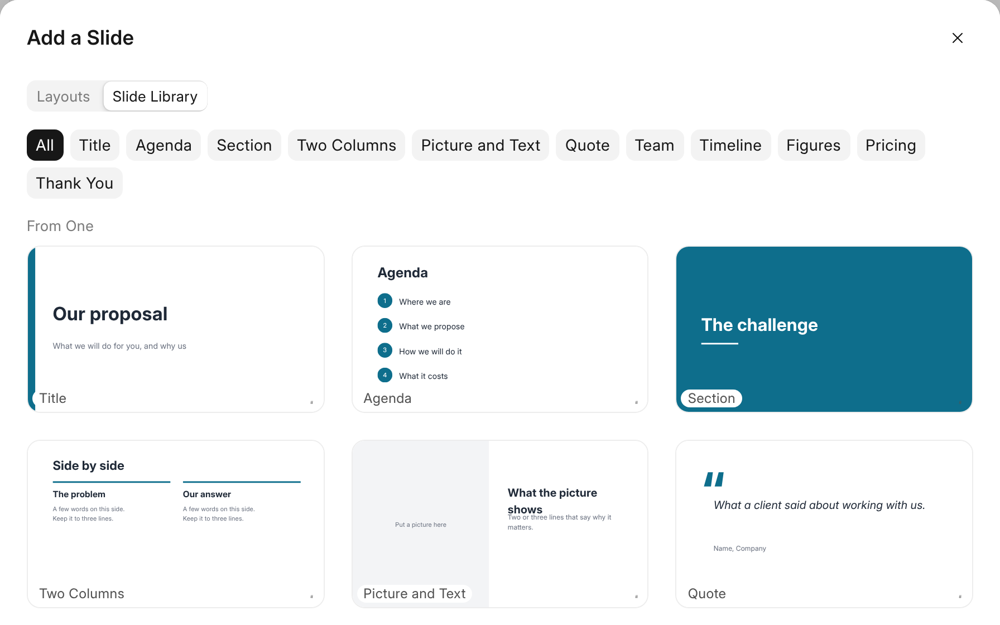
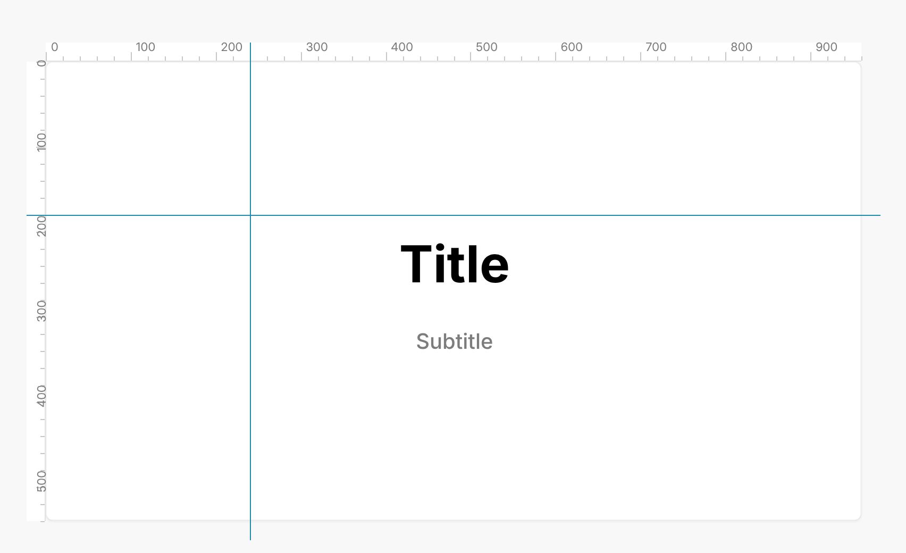
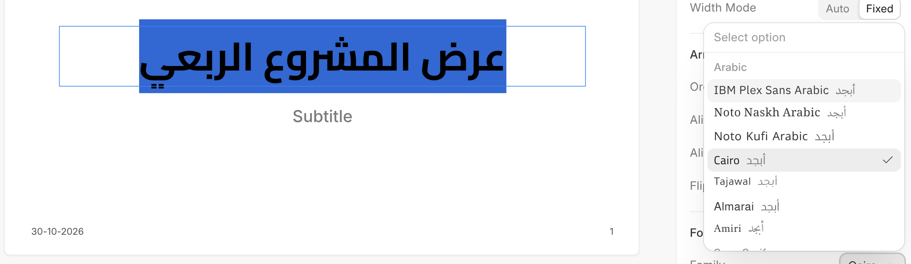
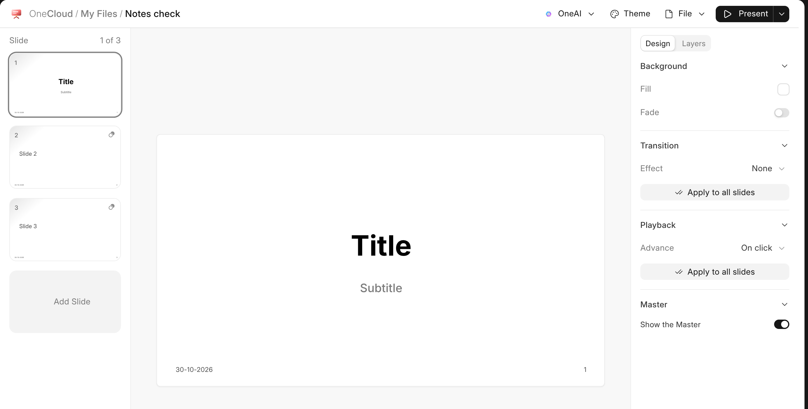
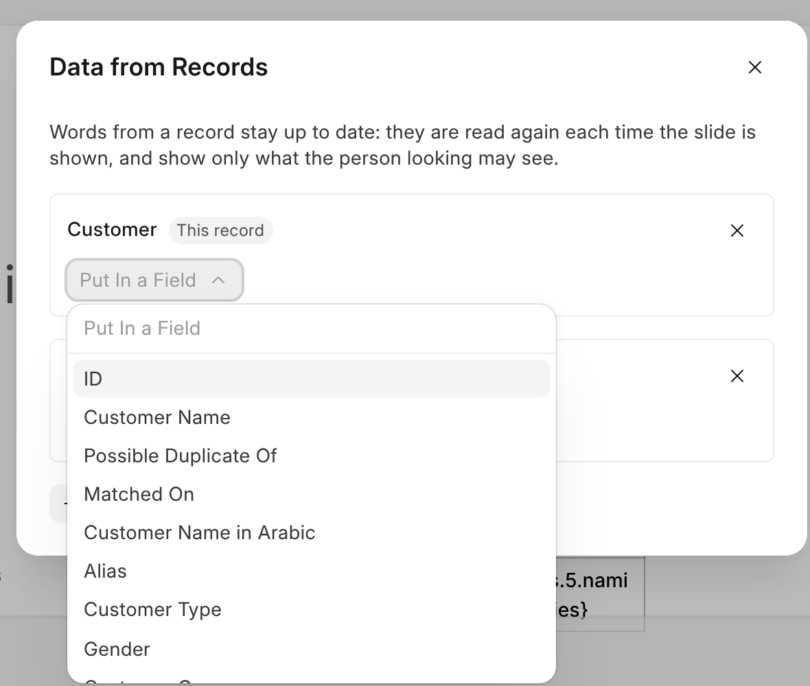

# Working on Slides

The slides are down the left. Click one to work on it, press **Add Slide**
for a new one from the theme's layouts, and drag a slide to move it.

## Adding Things

The bar under the slide adds text, a picture or a video, a shape, a line or
a connector, and a table. Besides the usual shapes there is a star and a
block arrow. Paste a picture, or drop one on the slide, and it is added too.

## Decks and the Slide Library

**New › Presentation** offers five decks ready to fill in: a pitch, a
project update, a tender response, a monthly review and a training session.
Each comes in your language and your business's colour and logo.

**Add Slide** has two tabs. **Layouts** are the theme's. **Slide Library**
has a finished slide of every kind (title, agenda, section, two columns,
picture and text, quote, team, timeline, figures, pricing, thank you), and
your company's own. A manager adds one with **Save to Library** on a
slide's menu in the rail, and takes it off with the cross on it.

## The Panel

Click anything on the slide and the panel on the right shows all it has:
where it stands and its size, how it lines up with the rest, its font and
paragraph, its fill, border and shadow, the crop of a picture, and how a video
plays. With nothing chosen, the panel is the slide's own: its background, how
it moves to the next slide, and when.

## Rulers and Guides

**File › Show Rulers and Guides** puts a ruler along the top and the side of
the slide. Drag down from the top ruler, or across from the side one, to lay
a guide; anything you move or resize near it snaps to it. Drag a guide to
move it, or off the slide to remove it. **Add Margin Guides** lays four, 40
pixels in from each edge, and **Clear Guides** removes them all. Guides are
kept with the presentation for everyone who works on it, and never show when
it is presented or printed.

## Fonts and Arabic

**Family**, in the panel for words, lists the workspace's fonts: seven
Arabic ones, each shown with a few Arabic letters, then the rest by kind.
Fonts your company adds come first, under **Your Fonts**. A manager adds one
with **Add a Font…** at the foot of the list: upload a .ttf, .otf, .woff or
.woff2 file, or, once **Fonts from Google** is on in TrustCenter, search
Google's catalogue and add a family. Every font is kept in the workspace, in
OneCloud › Fonts, and nobody's browser asks Google for it.

Each paragraph runs the way its first letter does, so Arabic reads from the
right and English from the left in the same box. **Direction**, under
Paragraph, sets a box to one way. In a workspace that reads Arabic, a new
presentation starts in an Arabic font.

## The Master

**File › Edit Master** opens what every slide draws underneath its own: a
logo, a footer, a line. **Add Slide Number** and **Add Date** put a small
text on it that becomes each slide's number and today's date. Click
**Done** to go back. A slide that should stand alone turns off **Show the
Master** in the panel, with nothing chosen on it.

## Layouts

A slide added from a template remembers which layout it came from. When
the template's look changes, **File › Restyle from Layouts** brings it into
every such slide: the title and text boxes move and take the new look, and
keep your words. Its background follows the layout too. What the slides
were is kept in **Version History**.

## Data from Records

**File › Data from Records** puts words from your records on a slide that
stay up to date. Add a source: the record the presentation is filed on, any
record, a record linked from another (the customer of this quotation), or a
list (this customer's quotations, at most 50). Then pick a field in **Put In a Field** to put it
on the slide. It shows as `{this.customer_name}` while you edit the text, and
as what the record says everywhere else: in the editor, when you present, on
a screen, and in PowerPoint. A list goes in as a table, or as its count or a
total. Each person sees only what they may read; for anyone else the field
is empty. When a record is saved, an open presentation shows the change.

**File › Freeze Data** writes in what the fields say now, for good; what the
slides were is kept in **Version History**. **File › Make One for Each…**
makes a copy filed on each record you pick, in the background, and each copy
reads its own record.

## Speaker Notes

**Speaker Notes**, under the slide, is what you will say over it. Click the
bar to open it and type; it is kept with the slide, in its versions, and
never shown to the audience.

## Themes and Presenting

**Theme** changes the theme the slide layouts come from: Light, Dark, or a
template your business keeps. **Present** plays the presentation full screen
from this slide or from the start, and can loop.

**Present › Presenter View** keeps your notes, the next slide and the time on
this screen and opens the slides in a window of their own: drag that window
to the projector and click **Fill the Screen**. The arrow keys, the space bar
or **Next** and **Back** move both together, with no network needed between
them; **End the Presentation** closes the slides' window.

## Two People at Once

If the same presentation is open in another tab, only one of them can change
it; the other says so and offers **Edit here**. If somebody else saved it in
the meantime, the editor says so and offers **Reload**.
