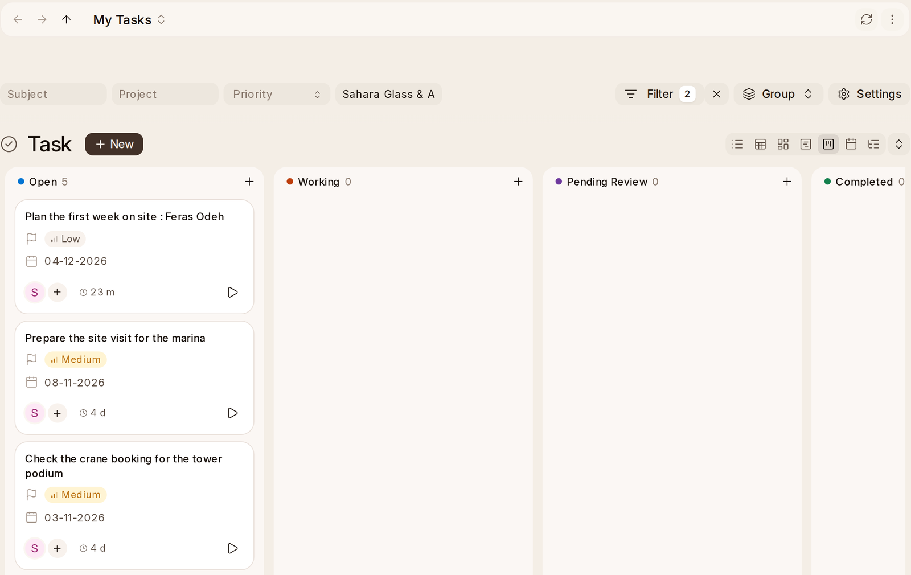

# My Tasks and Inbox

**My Tasks** is a board of everything assigned to you, a column for each
status: **Open**, **Working**, **Pending Review** and **Completed**. **Inbox**
is the same board for what's assigned to you and has no project, such as a
to-do you made yourself or a task OneAI made about a supplier's bill.

Each card shows the task's priority and its **Expected End Date**. Click a
card to open the task, or use the board's own filters, grouping and settings
as on any board.

## Adding and Finishing

**To add a task**, type it in **Add a task**, beside Add Task, and press Enter,
with an **Expected End Date** if it has one. It's assigned to you, has no
project, and lands in **Open** on both boards. The **+** at the top of a
column adds one there too.

**To move a task on**, drag its card to another column. Dragging it to
**Completed** completes it for everyone.

The play button on a card times the task. See [Timing a Task](timing).

## On the Calendar

Your tasks show on **OneCalendar** under **My Tasks**, on their due date.
**Drag a task to another day** to move it. The due date changes, and the
start date moves by the same number of days, so the task keeps its length.
