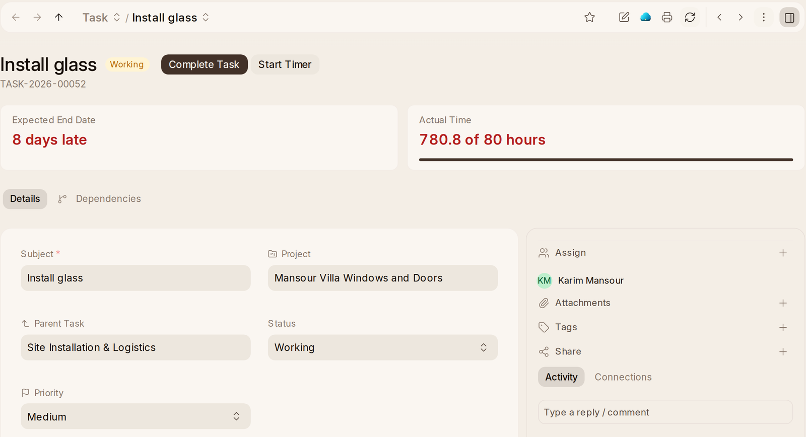

# A Task

A task opens on its form, wherever you open it from: My Tasks, the list, a
project's Tasks, the calendar or a notification. {one_task}'s rail stays beside
it.

Above the fields is what is worth knowing at a glance: when it is due, and how
many days **late** if it is; how far the **Checklist** has got; what it still
**Depends On**; and the hours logged against the plan. The address bar names
its project. The panel beside it has who it is assigned to, its files, tags,
who it is shared with and its activity.

**Complete Task** at the top completes it, and **Start Timer** times it. On
a phone both are in the **⋯** menu, with Print, Email, Duplicate, Delete and
the rest. What it depends on is under **Dependencies**.

## Making a Task

**Add Task** asks for the subject, the project if there is one, and the due
date. A project's own **New Task** asks for more: what it is part of, who
owns it, its priority, its dates, the hours planned and a description.

A task you create with no project and no one assigned is **assigned to you**,
so it shows on your calendar and in your lists. Anything that makes a to-do
without a record, such as a reminder to yourself, makes a task instead.

## Steps and Sub-tasks

**Child Tasks** lists the tasks under this one. A sub-task is a full task,
with its own people, dates and board card, in the same project as its parent.

**Checklist** is for steps toward finishing a task that don't need anyone
assigned. Tick each as you go. The task's progress follows, and so does the
project's if it tracks progress.
