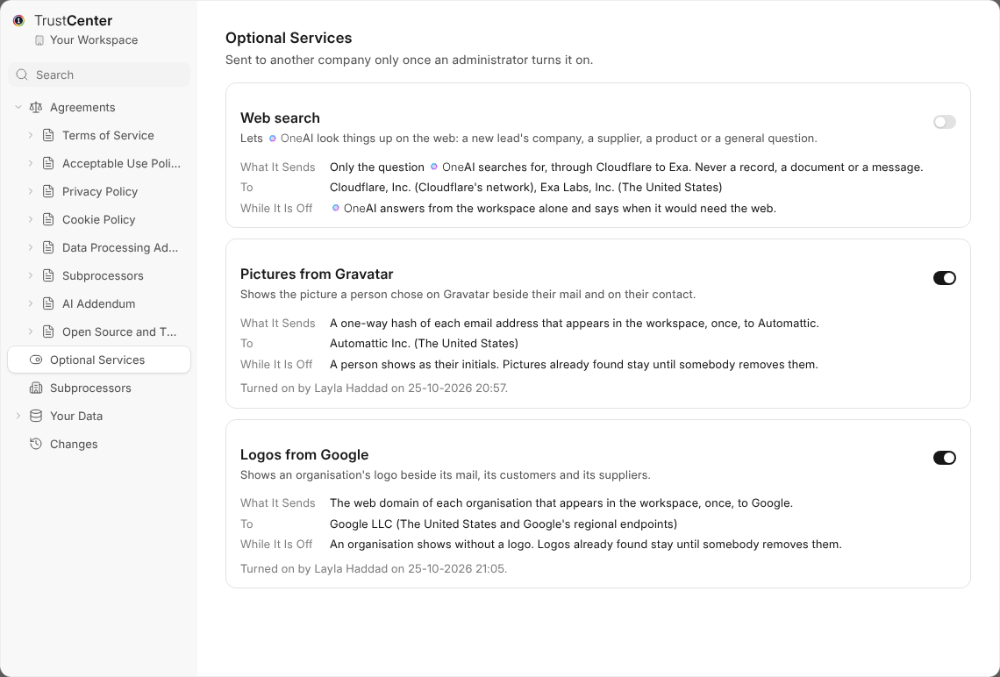

# Optional Services

An optional service sends something to another company, such as a picture
lookup or a web search. Each is off until a Workspace Administrator turns it
on in {trust_center}, under **Optional Services**.

## What Each Says

| Part | What it tells you |
| --- | --- |
| **What It Sends** | Exactly what leaves your workspace. |
| **To** | The company that receives it, and where. |
| **While It Is Off** | What {one} does instead. |

## Turning One On

Turning a service on agrees to it for the whole workspace, and is recorded
with your name and the day. Turning it off stops it at once.

If a service starts sending to somewhere new, it turns itself off until an
administrator agrees again.

> **The setup wizard asks too.** A new workspace is offered each service on
> a slide of its own, and nothing is on unless somebody turns it on there.
