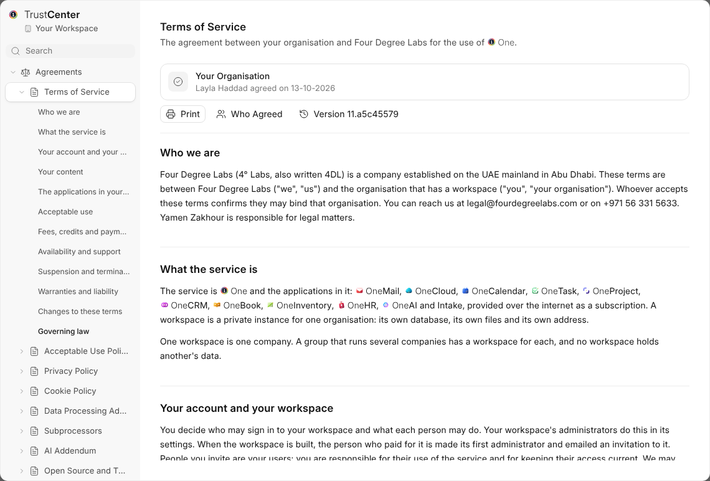

# What {trust_center} Is

{trust_center} holds the agreements {one} runs under, what your workspace has
agreed to, which other companies receive its data, and what is changing.
Open it from {one}'s rail. **Your Data** at the end of a module's Settings
opens the part of it that is that module's.

> **This is our own drafting, written from what {one} does.** It is not legal
> advice. The English text is the one that governs.

## The Agreements

| Agreement | What it covers |
| --- | --- |
| **Terms of Service** | The agreement between your organisation and Four Degree Labs. |
| **Acceptable Use Policy** | What {one} may not be used for. |
| **Privacy Policy** | Your personal data, and the personal data your organisation keeps in {one}. |
| **Cookie Policy** | What {one} keeps on your device. |
| **Data Processing Addendum** | How we handle the personal data your organisation is responsible for. |
| **Subprocessors** | Every other company that receives data, what it receives and where. |
| **AI Addendum** | How {one_ai} works and what happens to what it reads. |
| **Open Source and Third-Party Notices** | The software {one} is built from. Nobody has to agree to it. |

Every version somebody agreed to is kept, so you can always read exactly
what was agreed. **Print** prints the one open.

## Where to Start

| I want to | Read |
| --- | --- |
| Know who agrees to what, and when I'm asked | [Agreeing](agreeing) |
| Turn on a service that sends data elsewhere | [Optional Services](optional-services) |
| Know what changes and from when | [Changes](changes) |
| Decide who sees who agreed | [Who Can Do What](who-can-do-what) |
